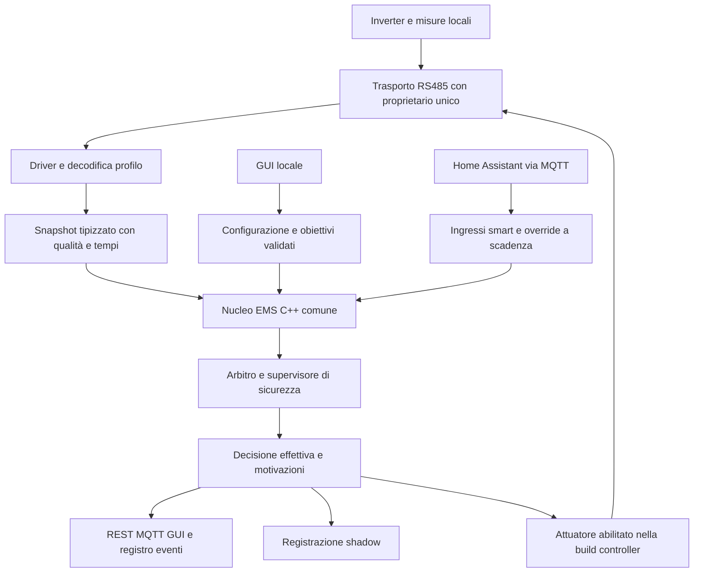

# Piano di implementazione Afore Autonomous EMS con riferimento OpenEMS

Versione 1.0 del 13 novembre 2026. Destinatario: agente incaricato dello sviluppo. Lingua del piano: italiano. Codice, commenti e documentazione tecnica aggiunta al repository: inglese, come richiesto da `AGENTS.md`.

## 1 Obiettivo e risultato da consegnare

Realizzare un gestore dell’energia autonomo per l’impianto Afore AF5K-SL, utilizzando il Raspberry come banco di sviluppo e lo stesso nucleo C++ sul futuro ESP32. Il sistema deve leggere l’impianto, scegliere una strategia, calcolare un setpoint, applicare limiti e protezioni, spiegare le decisioni e, nella versione di controllo validata, comandare l’inverter tramite il protocollo External EMS.

Home Assistant deve poter fornire informazioni smart e supervisionare tramite MQTT: previsioni FV, prezzi, meteo, obiettivi e override temporanei. Il controller deve continuare a funzionare con dati locali quando Home Assistant, MQTT o Internet non sono disponibili. Perdere HA non deve equivalere a perdere la gestione energetica.

La GUI deve rendere configurabili soglie, strategie e programmazioni effettivamente implementate. Ogni controllo disponibile deve avere un backend funzionante, validazione, persistenza, stato di applicazione e test. Non sono accettabili schermate dimostrative presentate come operative.

Il riferimento funzionale è OpenEMS, in particolare:

1. `Controller.Ess.Balancing`.
2. `Controller.Ess.GridOptimizedCharge`.
3. `Controller.Ess.LimitTotalDischarge`.
4. `Controller.Ess.TimeOfUseTariff`.
5. `Controller.Ess.FixStateOfCharge`.

Il risultato deve essere un adattamento coerente con le risorse ESP32 e con l’hardware Afore. La parità completa con OpenEMS non è un requisito implicito: differenze, semplificazioni e funzionalità escluse devono essere esplicite e testate.

## 2 Contesto operativo e fonti

### 2.1 Percorsi e impianto

| Elemento | Riferimento |
|---|---|
| Repository principale | `C:\Users\gianv\Documents\Progetti\ESP\afore-autonomous-ems` |
| Istruzioni del repository | `AGENTS.md`, da leggere prima delle modifiche |
| Documenti dell’impianto | `Doc/PIANO_Afore_Autonomous_EMS_V4.md`, `Doc/Afore_Autonomous_EMS_V4_Roadmap.md` |
| Protocollo EMS del produttore | `Doc/外部Ems调度  - En_240312.docx` |
| Tabella registri del produttore | file `.xlsx` v3.4 nella cartella `Doc` |
| Accesso al banco | `ssh afore-m3` |
| Sistema remoto osservato | Raspberry, Debian GNU/Linux 13.7, ARM64 |
| Dashboard osservata | `http://10.0.5.174:8080/` |
| Installazione corrente | `/opt/afore-ems` |
| Configurazione storica | `/etc/afore-ems/config.json` |
| Servizio corrente | `afore-shadow.service` con drop-in `live.conf` |
| Inverter di riferimento | Afore AF5K-SL, ibrido monofase da 5 kW secondo i documenti dell’impianto |
| Batteria di riferimento | Capacità configurata 10,24 kWh; limiti elettrici da confermare |
| Scheda prevista | Waveshare ESP32-S3-Relay-1CH-U secondo i documenti; verificare revisione reale |

Indirizzi IP, nomi USB e stato dei servizi sono una fotografia del 13 novembre 2026. Verificarli prima di operare. Non inferire il modello dell’inverter da vecchi dati dimostrativi della GUI.

### 2.2 Riferimento OpenEMS riproducibile

Repository: [OpenEMS/openems](https://github.com/OpenEMS/openems).

Commit esaminato in questa sessione: `769483ea2c2cc8be64fbf20094e70cea89f0f307`. È un riferimento di analisi, non una dichiarazione di versione stabile o collaudata sull’impianto.

La copia di consultazione di questa sessione è in `C:\Users\gianv\Documents\Codex\2026-11-13\c\work\openems`. L’agente deve poter ripetere l’analisi clonando il repository e fissando il commit, senza dipendere da questa directory.

Fonti principali da leggere nel commit indicato:

- [Balancing](https://github.com/OpenEMS/openems/tree/769483ea2c2cc8be64fbf20094e70cea89f0f307/io.openems.edge.controller.ess.balancing): implementazione, configurazione e test.
- [GridOptimizedCharge](https://github.com/OpenEMS/openems/tree/769483ea2c2cc8be64fbf20094e70cea89f0f307/io.openems.edge.controller.ess.gridoptimizedcharge): ritardo carica, limite immissione, previsioni, integrazione scheduler.
- [LimitTotalDischarge](https://github.com/OpenEMS/openems/tree/769483ea2c2cc8be64fbf20094e70cea89f0f307/io.openems.edge.controller.ess.limittotaldischarge): stati SOC minimo, carica forzata e isteresi.
- [TimeOfUseTariff](https://github.com/OpenEMS/openems/tree/769483ea2c2cc8be64fbf20094e70cea89f0f307/io.openems.edge.controller.ess.timeofusetariff): scheduler, stati, configurazione, test e API del piano.
- [FixStateOfCharge](https://github.com/OpenEMS/openems/tree/769483ea2c2cc8be64fbf20094e70cea89f0f307/io.openems.edge.controller.ess.fixstateofcharge): macchina a stati, handler, configurazione e condizioni di conclusione.
- [Ess Power](https://github.com/OpenEMS/openems/tree/769483ea2c2cc8be64fbf20094e70cea89f0f307/io.openems.edge.ess.power) e [Fixed Order Scheduler](https://github.com/OpenEMS/openems/tree/769483ea2c2cc8be64fbf20094e70cea89f0f307/io.openems.edge.scheduler.fixedorder): composizione dei vincoli e ordine di esecuzione. Non ridurre il coordinamento al solo ordine dei controller.
- [GUI ESS](https://github.com/OpenEMS/openems/tree/769483ea2c2cc8be64fbf20094e70cea89f0f307/ui/src/app/edge/live/Controller/Ess): pagine, impostazioni, grafici e gestione delle interazioni.

OpenEMS Edge/Backend dichiarano EPL-2.0; OpenEMS UI dichiara AGPL-3.0. Il progetto di partenza è MIT. Prima di importare codice, distinguere reimplementazione del comportamento, adattamento e copia; registrare fonti, licenze e attribuzioni in `LICENSE-THIRD-PARTY.md`. Rispettare la regola locale che richiede reimplementazione della conoscenza di protocollo. La GUI può riprendere struttura e comportamento senza copiare componenti Angular. Dubbi sulla compatibilità di un’importazione diretta vanno risolti prima dell’importazione, senza bloccare una reimplementazione indipendente.

## 3 Stato iniziale e problemi già emersi

### 3.1 Acquisizione temporanea attiva

La prima installazione avviava soltanto `deploy/web_ui.py`, che esponeva dati fissi. In questa sessione è stato aggiunto `deploy/live_backend.py` e configurato il servizio per usarlo. Il ponte legge il profilo TOML e acquisisce dati fisici tramite USB-RS485; non esegue il nucleo EMS C++ e non comanda l’inverter.

Parametri che hanno prodotto risposte valide: 9600 baud, 8N1, slave 1, FC04. Percorso stabile osservato: `/dev/serial/by-id/usb-1a86_USB_Serial-if00-port0`. Sono state osservate letture coerenti come SOC 70%, batteria circa 53 V, rete circa 234 V e 50 Hz. Questi dati dimostrano comunicazione funzionante durante una prova breve; non attestano durata, esattezza di tutti i registri o compatibilità del controllo.

Il ponte temporaneo espone dati e diagnostica reali, rifiuta le modifiche di configurazione e non abilita MQTT o Modbus TCP. Una copia precedente di servizio e GUI è in `/opt/afore-ems/backup-before-live-20261113`. Verificare che il backup copra tutti i file da sostituire prima del prossimo deployment.

### 3.2 Componenti da recuperare e integrare

| Componente | Stato da verificare e azione |
|---|---|
| `src/host/main.cpp` | Il ciclo principale esaminato era un placeholder; costruire il runtime reale |
| `src/ems/shadow_ems_controller.*` | Logica consultiva di autoconsumo esistente; verificarne formule, limiti e test prima di riusarla |
| `src/ems/target_aware_ems.*` | Pianificazione consultiva con SOC target, meteo, stagionalità e calibrazione; integrare e correggere, evitando un motore concorrente |
| `src/ems/ha_replay_engine.*` | Replay storico disponibile; verificare copertura e riuso |
| `src/ems/power_balance_evaluator.*` | Gestisce segni e bilancio, ma usa fallback a zero e può derivare un carico che rende il bilancio tautologico; correggere |
| `src/drivers/afore/afore_telemetry_engine.*` | Usava FC03 e indirizzi/formati non allineati alle correzioni del TOML; non assumere che il profilo corretto sistemi questo decoder |
| `profiles/afore/af5k_sl.toml` | Corretto durante la prova; riconvalidare tutte le righe sul documento e sull’hardware |
| `src/drivers/afore/afore_v4_mqtt.*` | Generazione discovery/payload presente, non prova di connessione MQTT nel runtime |
| `src/main.cpp` | Runtime firmware esistente da integrare; verificare percorso effettivo fino a EMS e attuatore |
| `platformio.ini` | Ambiente shadow esistente; diverse macro dichiarate non risultavano consumate nei sorgenti |
| `CMakeLists.txt` | `target-aware-ems-core` risultava definito nell’area test; renderlo dipendenza reale del runtime |
| Web UI | Monitoraggio Heliograph con modifiche locali; aggiungere gestione energetica con API reali |

Non cancellare modifiche locali. La working tree contieneva cambi a `deploy/web_ui.py`, profilo Afore, header web e il nuovo ponte, oltre a `Doc/` non tracciata. I file non tracciati possono contenere requisiti essenziali e non sono materiale da eliminare.

## 4 Confini di lavoro e regole per l’agente

Questo incarico di pianificazione non esegue nuovo sviluppo o attivazioni sull’impianto. Quando l’utente affiderà lo sviluppo, l’agente deve progredire autonomamente nelle attività autorizzate e nei test offline. Non aggiungere richieste di conferma a ogni fase.

L’installazione corrente resta in lettura. La transizione a controllo reale deve essere una fase esplicita, con build identificata, limiti validati, procedura di prova e autorizzazione che includa scritture all’inverter. Il precedente comando “avvia tutto” è stato eseguito come avvio della lettura e non va riutilizzato come prova di autorizzazione a qualsiasi futura scrittura.

Regole obbligatorie:

1. Leggere `AGENTS.md` e le eventuali istruzioni più specifiche. Non indebolire i check per farli passare.
2. Conoscenza Afore, registri e conversioni nel driver/profili; EMS, GUI e output restano generici.
3. Niente dati inventati nel runtime fisico. I simulatori devono essere identificabili e separati.
4. Dato sconosciuto diverso da zero; comando assente diverso da comando 0 W.
5. Un solo proprietario della seriale e un solo attuatore di setpoint.
6. Nessuna modifica al bus BMS/COM2 o al cablaggio senza attività dedicata autorizzata.
7. Non scrivere dinamicamente parametri permanenti come `0x0BC1` e `0x0BC2`. L’esclusione deve essere strutturale, senza dipendere soltanto dal rischio EEPROM descritto nei vecchi documenti.
8. Niente cambio di modalità nativa per inseguire ogni oscillazione di potenza.
9. Non rimuovere `ReadOnlyGuard` dalla build shadow per aggiungere il controllo: costruire un percorso distinto e limitato.
10. Non inviare messaggi, notifiche o comandi a servizi esterni estranei all’integrazione autorizzata.
11. Nessun commit/push o flash dedotto dalla sola richiesta di preparare il piano.
12. Riportare separatamente codice scritto, test eseguiti, deployment, prove fisiche ed elementi non validati.

## 5 Architettura di destinazione



La parte centrale non dipende da Arduino, FreeRTOS, Wi-Fi, MQTT, registri Modbus, file o servizi HTTP. Riceve input e tempo espliciti e restituisce una decisione. I due runtime assemblano gli stessi moduli; cambiano i trasporti e gli adattatori di sistema.

### 5.1 Moduli proposti

I nomi seguenti sono una proposta. Riutilizzare strutture esistenti quando adatte; evitare un secondo albero funzionale equivalente.

| Area | Responsabilità |
|---|---|
| `src/ems/model/` | Snapshot, qualità, tempo, limiti, obiettivi e decisioni |
| `src/ems/controllers/` | Balancing, priorità carica, carica ottimizzata, SOC programmato, tariffa |
| `src/ems/constraints/` | Riserva, SOC massimo, limiti hardware, import/export consentiti |
| `src/ems/planner/` | Previsioni normalizzate, target e pianificazione tariffaria limitata |
| `src/ems/supervisor/` | Arbitraggio, autorità, fallback e stato operativo |
| `src/drivers/afore/` | Decodifica Afore, capacità validate e attuatore External EMS |
| `src/config/` | Schema persistente, migrazioni, validazione e revisione |
| `src/outputs/` | REST, MQTT, discovery e rappresentazione delle decisioni |
| `src/host/` | Runtime Linux e adattatori host |
| `src/main.cpp` e HAL | Integrazione ESP32 senza duplicare gli algoritmi |

### 5.2 Tipi minimi e separazione delle responsabilità

Definire almeno `TelemetrySnapshot`, `SmartInputSnapshot`, `EmsConfig`, `HardwareCapabilities`, `ControlIntent`, `ConstraintSet`, `EmsDecision` e `ActuationStatus` o equivalenti.

Una decisione deve includere richiesta originale, richiesta dopo vincoli, potenza effettivamente inviata, strategia selezionata, strategia effettiva, motivazione primaria, vincoli intervenuti, sorgente dell’autorità, età input, revisione configurazione e ID decisione. L’attuatore pubblica esito e conferma separati: inviare un frame non dimostra che l’inverter abbia seguito il comando.

Gli input devono essere bounded: numero massimo slot, dimensione messaggi, lunghezza stringhe, coda eventi e memoria del planner. Niente allocazioni continue nel ciclo rapido. L’agente misura la memoria reale sul firmware, inclusi stack, TLS e buffer web.

## 6 Convenzioni fisiche e qualità dei dati

### 6.1 Convenzioni interne

Adottare e documentare una sola convenzione:

- `grid_power_w > 0`: importazione; `< 0`: esportazione.
- `battery_power_w > 0`: carica; `< 0`: scarica.
- `pv_power_w >= 0`: produzione FV lato dichiarato.
- `inverter_ac_power_w > 0`: potenza AC erogata dall’inverter, salvo conferma del segno fisico.
- Potenze in W, capacità/energia in Wh o kWh con nomi espliciti, SOC in punti percentuali.

Il segno e il lato AC/DC del protocollo si convertono nel driver, una volta sola. OpenEMS usa convenzioni proprie: non copiare formule senza trasformarle e verificarle con casi numerici.

Per un meter al punto di connessione e una potenza AC dell’inverter sincronizzata, `load_ac ≈ inverter_ac + grid_power`, con le altre sorgenti/rami eventualmente misurati inclusi esplicitamente. Il bilancio da FV DC e batteria deve considerare perdite e topologia. Un carico derivato dalla stessa equazione non costituisce una validazione indipendente del bilancio.

### 6.2 Campione e snapshot

Ogni misura contiene valore opzionale, valore raw quando disponibile, timestamp monotono di ricezione, timestamp civile se affidabile, età, unità, provenienza, qualità e stato di validazione della mappa. Separare validità del frame, plausibilità della misura e verifica della mappatura.

Stati minimi: `VALID`, `STALE`, `INVALID`, `OUT_OF_RANGE`, `COMM_ERROR`, `UNAVAILABLE`, `UNVERIFIED`. Un campione mai ricevuto non ha timestamp fittizio né valore zero. Conservare l’ultimo valore come storico diagnostico senza renderlo azionabile.

La scadenza dei dati deve essere aggiornata anche se il circuit breaker è aperto o il polling è sospeso. Un early return non deve congelare campioni come validi.

Uno snapshot per controllo deve rispettare un limite di disallineamento temporale fra SOC, potenza batteria, rete e inverter. Se i blocchi sono troppo distanti o i dati critici non sono verificati, il controllo attivo non è ammesso. Il solo `UNVERIFIED` può essere sufficiente per visualizzazione e shadow, non per sbloccare l’attuazione.

### 6.3 Mappa registri da riconfermare

La tabella seguente deriva dal foglio operativo del produttore esaminato. È una base di verifica, non una prova di compatibilità universale del firmware Afore.

| Misura | Indirizzo decimale | Tipo | Scala e nota |
|---|---:|---|---|
| Tensione rete R | 507 | U16 | 0,1 V |
| Frequenza rete R | 513 | U16 | 0,01 Hz |
| Potenza AC totale inverter | 522–523 | S32 | W |
| Potenza rete R del meter | 529–530 | S32 | W; verificare che rappresenti il punto di connessione |
| Potenza FV totale | 553–554 | U32 | W |
| PV1 tensione e corrente | 555 e 556 | U16 | 0,1 V e 0,01 A |
| PV1 potenza | 557 | U16 | W |
| PV2 tensione e corrente | 558 e 559 | U16 | 0,1 V e 0,01 A |
| PV2 potenza | 560 | U16 | W |
| Stato batteria | 2000 | U16 | Enum da validare |
| Temperatura batteria | 2001 | S16 | 0,1 °C |
| SOC | 2002 | U16 | % |
| Tensione batteria | 2004 | U16 | 0,1 V |
| Corrente batteria | 2005 | S16 | 0,01 A; produttore indica positivo in scarica |
| Potenza batteria | 2007–2008 | S32 | W; inversione per convenzione interna |
| Temperatura dissipatore | 2515 | S16 | 0,1 °C |

Verificare FC04, ordine parole, signedness, sentinelle, limiti di blocco e presenza dei registri sul dispositivo reale. Testare valori negativi come −2000 W: la lettura della sola parola bassa può apparire corretta con potenze positive piccole e fallire in carica.

## 7 Modalità operative e autorità

### 7.1 Modalità di esecuzione

Distinguere sempre:

| Modalità | Effetto |
|---|---|
| `MONITOR` | Legge e visualizza; nessuna decisione di controllo applicata |
| `SHADOW` | Calcola e registra decisioni con gli stessi algoritmi della modalità attiva; zero scritture |
| `ACTIVE` | Applica decisioni soltanto con capacità, qualità e protezioni soddisfatte |
| `SUSPENDED` | Sospende il comando seguendo una transizione esplicita; non significa automaticamente 0 W |
| `FAULT` | Stato di guasto con motivo, azione intrapresa e limite del fallback |

La modalità di esecuzione è distinta dalla strategia e dalla modalità nativa inverter. Mostrare separatamente `requested_strategy`, `effective_strategy`, `inverter_mode_observed`, `inverter_mode_requested` e conferma del cambio.

### 7.2 Strategie selezionabili

- `SELF_USE`: autoconsumo con target rete.
- `CHARGE_FIRST`: priorità carica verso un SOC, entro limiti FV/rete autorizzati.
- `GRID_OPTIMIZED_CHARGE`: carica differita/previsionale e assorbimento surplus.
- `TIME_OF_USE`: strategia economica con pianificazione.
- `SCHEDULED_SOC`: obiettivo di SOC a una scadenza, con mantenimento opzionale.
- `MAINTENANCE`: procedura limitata nel tempo, appoggiata a SOC programmato e condizioni di completamento esplicite.
- `NATIVE_INVERTER`: richiesta di restituzione del controllo alla gestione nativa, dopo conferma fisica.

La riserva SOC e la protezione da scarica non sono strategie alternative: restano vincoli. Maintenance non autorizza automaticamente carica da rete, scarica profonda o modifica dei limiti BMS.

### 7.3 Ordine decisionale proposto

1. Disponibilità del controllo e condizioni di sicurezza.
2. Validità e coerenza dei dati critici.
3. Limiti hardware/BMS e limiti operativi approvati.
4. Riserva SOC e permessi di import/export o carica da rete.
5. Autorità selezionata ed eventuale override temporaneo valido.
6. Obiettivo SOC e programma attivo.
7. Strategia economica/previsionale.
8. Strategia locale di base.
9. Rampa, deadband e nuova applicazione dei vincoli finali.

Se il filtro di rampa impedisce di rispettare un nuovo limite più restrittivo, il limite prevale subito. Tutti i limiti finali vengono ricontrollati immediatamente prima della trasmissione.

L’agente deve distinguere vincoli duri e preferenze. Se carica da rete è vietata e manca FV per il target, dichiarare target irraggiungibile. Non superare il divieto per soddisfare l’orario. Una eventuale carica di emergenza sotto SOC critico richiede una politica distinta, esplicitamente configurata e validata.

## 8 Specifica dei controller

### 8.1 Balancing e Self Use

Obiettivo: regolare la batteria per portare lo scambio rete a `target_grid_power_w`. Il target può includere un piccolo margine di importazione, ma nessun valore va imposto senza misura della dinamica reale.

Con segno interno positivo in carica, una prima legge ideale per controllo diretto batteria è `P_batt_request = P_batt_measured − (P_grid_measured − P_grid_target)`. È un modello di partenza che trascura perdite e ritardi: la conversione fra lato AC e DC va validata. Se si sceglie controllo potenza AC, il modello e il driver devono riflettere quel lato invece di riutilizzare questa formula.

Esempi ideali per i test:

- Batteria ferma, import 600 W, target 0: richiesta batteria −600 W.
- Batteria già a −400 W, import residuo 100 W: richiesta −500 W, non −100 W.
- Batteria ferma, export 800 W: richiesta +800 W.
- SOC alla riserva: richiesta di scarica limitata a zero, senza eliminare produzione FV.

Parametri: target rete, deadband, isteresi, frequenza valutazione, rampa in W/s, potenza minima effettiva e permesso scarica. Testare rumore attorno allo zero e ritardi con un modello di impianto, non soltanto con assert sulla formula.

### 8.2 Limit Total Discharge e riserva

Implementare stati `NORMAL`, `RESERVE_HOLD`, `CRITICAL_SOC`, `RECOVERY` o equivalenti. Definire soglie di ingresso/uscita e tempo minimo fra transizioni. Il vincolo è sulla batteria: non deve spegnere involontariamente l’uscita FV di un inverter ibrido.

Configurare SOC minimo ordinario, soglia critica opzionale, isteresi in punti SOC, isteresi temporale, eventuale carica di recupero e suo tetto. La carica di recupero da rete deve rispettare un permesso specifico, distinto dal permesso di ottimizzazione tariffaria.

Se il SOC manca o il BMS segnala indisponibilità, non assumere condizioni normali. Il supervisore rende il setpoint non azionabile o avvia il fallback definito.

### 8.3 Charge First

È una strategia richiesta per questo prodotto, non un sinonimo di GridOptimizedCharge. Preferisce la carica rispetto all’uso ordinario della batteria fino a target, rispettando carichi, disponibilità e permessi.

Definire due varianti esplicite: priorità carica con solo FV disponibile e priorità carica con integrazione da rete autorizzata. Non descrivere come “solo FV” una funzione che può aumentare stabilmente il prelievo rete.

Stati: carica richiesta, limitata, target raggiunto, impossibile per mancanza energia, sospesa per qualità dati. Il raggiungimento del target non deve generare continue commutazioni: applicare isteresi e scelta del comportamento successivo.

### 8.4 Grid Optimized Charge

Obiettivo: mantenere capacità disponibile nelle ore utili e assorbire produzione che altrimenti eccederebbe il limite di immissione, senza perdere gli obiettivi SOC prioritari.

Input: previsione FV e carico, capacità utile residua, SOC, limite export, orario target, rischio ammesso. Output: tetto o richiesta di carica, orario previsto di avvio, SOC previsto e motivazione. Evitare di riempire la batteria al mattino se il pomeriggio si prevede surplus non esportabile, salvo target o vincoli prioritari.

Implementare fallback locale quando la previsione scade. La previsione è un’informazione, non una misura: età e incertezza devono apparire nello stato. Il limite export realizzato via polling è un obiettivo di regolazione; non sostituisce una protezione certificata e non garantisce assenza di transitori.

Riprendere da OpenEMS il comportamento utile, senza importare campi deprecati della configurazione come se fossero il contratto corrente. Nel commit analizzato alcuni parametri del limite immissione sono già migrati verso metadati globali.

### 8.5 Time Of Use Tariff

Il modulo può essere disabilitato; non deve impedire Self Use o controllo locale. Supportare prima bilanciamento, ritardo scarica e carica da rete consentita. Scarica verso rete per arbitraggio resta una capacità separata, inizialmente disabilitata.

Preparare una matrice rispetto agli stati OpenEMS: balancing, delay discharge, charge grid, discharge grid, peak shaving, delay charge, limit charge, avoid grid sell limit e discharge consumption. Indicare per ciascuno se supportato, semplificato o escluso. Non ridurre OpenEMS a tre stati e dichiarare piena equivalenza.

Modello proposto per la prima implementazione ESP32: ottimizzatore discreto bounded, con un numero limitato di slot e livelli SOC. Valutare programmazione dinamica rispetto a un baseline semplice; scegliere con un ADR dopo misura di RAM, tempo e qualità del piano. Non imporre il porting dello scheduler Java.

La funzione costo considera prezzo acquisto completo ricevuto, ricavo vendita, efficienze e un eventuale costo configurato di usura/ciclo. Precisare se gli oneri sono inclusi; non inventare prezzi o costi mancanti. Gestire prezzi negativi, tariffe piatte, dati assenti e target SOC terminale. Nessuna carica e scarica simultanee nello stesso slot del modello.

Rappresentare slot in UTC con durata esplicita. Per slot locali da 15 minuti, un giorno con cambio DST può averne 92 o 100: non assumere sempre 96. Un orizzonte fino a 48 ore può richiedere fino a 200 slot; il limite esatto e il budget di memoria vanno fissati e testati prima dell’implementazione.

Il piano è consultivo fino al vincolo in tempo reale. Non applicare ciecamente un piano se SOC, carichi o limiti sono cambiati. Ripianificare con cadenza limitata e su eventi significativi, senza bloccare heartbeat o acquisizione.

### 8.6 Fix State Of Charge e Maintenance

Gestire un obiettivo raggiunto appena possibile oppure a una scadenza, con banda SOC e mantenimento opzionale. Definire stati di attesa, avvicinamento, mantenimento, completamento, annullamento, impossibilità e guasto.

Parametri: target, orario o deadline, giorni/ricorrenza, durata mantenimento, tolleranza SOC, potenze massime, permesso rete, strategia di ritorno, timeout massimo e identificativo operazione. Uno stesso evento non deve ripartire dopo ogni riavvio.

Maintenance usa questa macchina a stati per una carica piena controllata quando appropriata. Il criterio storico “100% per 5 minuti” deve essere rappresentato come criterio configurato di completamento; non prova da solo un’avvenuta calibrazione interna del BMS. Pubblicare `full_charge_hold_completed` e dichiarare calibrazione BMS confermata solo se esiste un riscontro specifico.

L’eccezione al SOC massimo di longevità può alzare il target operativo fino al massimo approvato per la procedura, ma non superare limiti di sicurezza o BMS. Annullamento, perdita alimentazione e guasto devono portare a una transizione definita, senza mantenere per sempre un override.

### 8.7 Recupero delle funzioni smart già previste

Conservare e integrare i requisiti dell’impianto: target entro le 15:30, anticipo 20 minuti, finestra finale 60 minuti, correzione previsione, nebbia, carico feriale/weekend, priorità stagionale e ritorno alla strategia ordinaria. Tracciarli rispetto agli ID `R-TGT`, `R-NRG`, `R-PV`, `R-FOG`, `R-LOAD`, `R-SEA`, `R-CAL`, `R-CMD`, `R-DIA` e `R-SAF` del vecchio piano.

Normalizzare le previsioni Solcast: `pv_estimate` può rappresentare una potenza media in kW per uno slot; convertire in energia moltiplicando per la durata effettiva. Non trattare 30 minuti come un’ora. Proratare lo slot corrente e il tratto che termina all’orario target. Nebbia e correzione reale/previsto non devono essere applicate due volte.

Se non c’è previsione, “conservativo” significa un comportamento esplicito nei limiti configurati. Non promettere il target senza energia disponibile e non autorizzare implicitamente importazione o scarica.

## 9 Configurazione e valori iniziali

Tutti i valori devono avere unità, intervallo, default, persistenza, fonte e vincolo di modifica. Separare valori storici dell’impianto, default software e limiti confermati dell’hardware.

| Gruppo | Parametri minimi | Valori di riferimento e condizioni |
|---|---|---|
| Esecuzione | monitor/shadow/active, strategia base | Default shadow per le nuove build EMS |
| Batteria | capacità, SOC minimo/massimo, tensione nominale | 10,24 kWh e 51,2 V dai documenti; SOC minimo 15% come riferimento da confermare |
| Potenze | carica/scarica massime, minimo comando, limiti dinamici disponibili | 256–2560 W sono riferimenti storici, non autorizzazioni elettriche |
| Obiettivo | SOC target, orario, anticipo, recupero | 100%, 15:30, 20 min e 60 min dai requisiti storici; profilo longevità opzionale |
| Balancing | target rete, banda neutra, rampa e isteresi | Valori da tarare su latenza e rumore reali |
| Permessi | carica rete, scarica batteria, export da batteria | Disabilitati finché non validati e deliberatamente configurati |
| Previsioni | età massima, fonte, quantile, correzione | 14 h come riferimento; adattare alla frequenza reale della fonte |
| Carichi | feriale, weekend, giorni | 0,6 e 0,9 kW come fallback stimato, non misura |
| Stagionalità | date, valutazione e soglie | 25/10–28/02, 08:30 e criteri del piano storico |
| Maintenance | SOC, hold, timeout e ritorno | 100% per 5 min è il riferimento storico di hold |
| Tariffa | valuta, slot, prezzi, usura, orizzonte | Nessun prezzo fittizio come fallback |
| MQTT | broker, TLS, discovery, topic, TTL | Credenziali non leggibili dalle API |
| Robustezza | stale time, skew, timeout e rientro | Proposti in M1 e validati prima di ACTIVE |

Serializzare uno schema versionato con revisioni monotone e aggiornamento atomico. Rifiutare combinazioni incoerenti, per esempio SOC minimo maggiore del massimo, limite negativo, target fuori dal profilo o modalità non supportata. Validare NaN, Infinity, overflow e conversioni numeriche prima del salvataggio.

Le rampe devono essere in W/s. I vecchi riferimenti in W per ciclo vanno convertiti usando la durata esplicita, altrimenti cambiare il polling cambia il comportamento fisico.

Persistenza: configurazione stabile in flash/NVS con protezione da power loss; stato transitorio in RAM; checkpoint rari solo quando necessari. Non salvare ogni ciclo o ogni misura. Le credenziali restano separate dagli export ordinari.

## 10 Contratto MQTT e Home Assistant

### 10.1 Direzione e proprietà dei dati

L’ESP32 possiede misure locali, limiti applicabili, stato della strategia e comando effettivo. HA fornisce dati opzionali e richieste. Una misura di rete proveniente da HA non sostituisce automaticamente il meter locale: deve essere selezionata, datata, verificata e sottoposta a un limite di latenza.

La stessa API di dominio valida richieste della GUI e di MQTT. Nessun handler MQTT scrive direttamente registri o richiama il driver. Le richieste entrano in una coda bounded e diventano visibili nello stato dopo validazione.

### 10.2 Topic proposti

Prefisso: `ems/<device_id>/v1`. Definire ID stabili e migrazione dai topic esistenti prima di pubblicare discovery.

| Topic | Direzione | Retain e comportamento |
|---|---|---|
| `/availability` | Controller → HA | Retained, birth/LWT; distinguere online MQTT da controllo disponibile |
| `/telemetry` | Controller → HA | Preferibilmente non retained; timestamp e qualità obbligatori |
| `/state` | Controller → HA | Retained se include timestamp/boot ID e non implica freschezza delle misure |
| `/decision` | Controller → HA | Decisione effettiva, motivi e vincoli |
| `/config/reported` | Controller → HA | Configurazione senza segreti e revisione |
| `/config/set` | HA → Controller | PATCH validato con revisione attesa; mai abilita da solo ACTIVE |
| `/smart/forecast/set` | HA → Controller | Fonte, generated_at, expires_at, unità e slot |
| `/smart/tariff/set` | HA → Controller | Valuta, componenti prezzo, slot e scadenza |
| `/smart/weather/set` | HA → Controller | Valori opzionali, qualità e tempo |
| `/override/set` | HA → Controller | Non retained; lease temporanea con ID e scadenza |
| `/override/cancel` | HA → Controller | Annullamento idempotente con identificatore |
| `/ack/<request_id>` | Controller → HA | Accettazione/rifiuto; invio comando non equivale ad applicazione fisica |

I topic sono una proposta da consolidare in M1, non un contratto già disponibile. Documentare QoS, ACL broker, payload massimi e frequenze. Con QoS 1 gestire duplicati: la consegna “almeno una volta” non autorizza esecuzioni ripetute.

### 10.3 Esempio di override

```json
{
  "schema_version": 1,
  "request_id": "ha-20261113-00042",
  "issued_at": "2026-11-13T16:00:00Z",
  "expires_at": "2026-11-13T16:15:00Z",
  "expected_config_revision": 12,
  "strategy": "charge_first",
  "target_soc_pct": 85,
  "maximum_charge_power_w": 1500,
  "allow_grid_charge": false
}
```

L’override può ridurre i limiti ma non superarli, e non può alzare un permesso globale negato. `allow_grid_charge=false` restringe un permesso; `true` non può crearne uno. Rifiutare messaggi scaduti, duplicati incompatibili, versioni non supportate, retained non ammessi e timestamp futuri oltre la tolleranza.

Se l’orologio civile non è affidabile, rifiutare lease assolute nuove; non ripartire con una durata piena da messaggi retained vecchi. Le lease già accettate usano anche un termine monotono che non si allunga per correzioni NTP. Al riavvio non riprendere override manuali temporanei per default.

Definire un arbitraggio fra GUI e HA: un’operazione locale temporanea prende il controllo secondo una regola pubblicata e visibile, senza duellare con HA. Una richiesta proveniente da HA non può autoattribuirsi la priorità “sicurezza”.

### 10.4 Entità e automazioni HA

Sensori: strategia effettiva, sorgente, SOC target, scadenza, potenza richiesta/inviata/osservata, motivo limitazione, qualità, forecast age, tariff age, heartbeat e stato attuatore. Controlli: select strategia, number target/limiti ammessi, orari e pulsanti avvio/annullamento delle operazioni supportate.

Le entità di comando non supportate restano assenti o chiaramente non disponibili. Non esporre un interruttore HA che abilita scritture senza la catena locale di autorizzazione. Discovery con unique ID stabili, disponibilità corretta, pulizia dei topic rimossi e nessuna duplicazione a ogni riavvio.

Consegna un package HA di esempio con ingressi Solcast, meteo, tariffe e override. Non riattivare vecchie automazioni Solarman che scrivono all’inverter in parallelo al nuovo EMS.

## 11 GUI di gestione energetica

### 11.1 Struttura

Conservare accesso a misure, dispositivi e diagnostica. Aggiungere un’area EMS coerente con le viste di OpenEMS, adattata alla pagina embedded e utilizzabile da telefono. Niente dipendenza da CDN, librerie cloud o bundle Angular completo senza un confronto misurato con flash, RAM e tempi.

| Pagina | Informazioni e azioni |
|---|---|
| Panoramica EMS | Flussi, SOC, strategia, stato shadow/active, autorità, decisione spiegata e allarmi |
| Strategie | Selezione strategia, comportamento, requisiti e parametri contestuali |
| Batteria e limiti | Riserva, longevità, potenze, permessi, limiti confermati e fonte |
| SOC programmato | Target, scadenza, mantenimento, ricorrenza, fattibilità e annullamento |
| Carica ottimizzata | Previsioni, avvio previsto, limite export, rischio e fallback |
| Tariffe e piano | Prezzi, SOC previsto, azioni previste, costo stimato e condizioni del modello |
| Maintenance | Procedura, target, hold, timeout, progresso e ritorno |
| Home Assistant | Broker, disponibilità, ultimo dato, autorità e lease attiva |
| Diagnostica EMS | Input usati, qualità, vincoli, decisioni e attuazione/readback |

### 11.2 Comportamento di ogni form

Caricare configurazione effettiva e revisione; distinguere modifiche locali non salvate. Mostrare unità e validazione prima dell’invio e validare di nuovo sul backend. Salvare atomicamente; mostrare separatamente “salvato”, “applicato al motore” e “confermato dall’inverter”.

Se un altro client modifica la stessa configurazione, rispondere con conflitto e ricaricamento guidato. Evitare merge ciechi che sovrascrivono modifiche di HA. Un errore di salvataggio non deve apparire come successo.

Per operazioni temporanee mostrare ora di fine e pulsante annulla. Per parametri non supportati indicare perché e cosa manca. In shadow permettere la configurazione della strategia e mostrare la decisione ipotetica, senza far credere che stia modificando il comportamento reale.

### 11.3 Esempio di pannello decisione

```text
Esecuzione: SHADOW
Strategia selezionata: SOC programmato
Obiettivo: 85% entro le 15:30
SOC attuale: 70% — dato ricevuto 2 s fa
Potenza proposta: +1200 W verso la batteria
Potenza inviata: nessuna — scritture disabilitate
Vincolo intervenuto: carica dalla rete vietata
Fattibilità: non raggiungibile con il surplus previsto
Sorgente: programmazione locale
```

Questo è un esempio di contenuto, non un dataset da incorporare nel runtime fisico.

### 11.4 Qualità UI

Viewport di prova: 390, 768 e 1280 px; mouse, tastiera e touch. Contrasto, focus e messaggi accessibili; nessun colore come unico indicatore di errore. Mostrare un valore sconosciuto come “non disponibile”, mai 0 per convenienza grafica.

Grafici separano misure e previsioni, mostrano unità e copertura temporale e interrompono la linea nei gap. Non concatenare dati simulati e fisici nello stesso storico. Testare perdita SSE, riconnessione, pagina nascosta, più client e browser rimasto aperto durante un riavvio.

## 12 REST e persistenza

Conservare le API già usate dalla GUI oppure introdurre una migrazione esplicita. Nuovi endpoint proposti:

- `GET /api/v1/ems/state`: stato corrente e ultimo esito di attuazione.
- `GET /api/v1/ems/config`: configurazione redatta, revisione e capacità.
- `PATCH /api/v1/ems/config`: transazione con revisione attesa.
- `GET /api/v1/ems/plan`: piano, origine input e ragioni.
- `POST /api/v1/ems/operations`: avvio operazione temporanea idempotente.
- `DELETE /api/v1/ems/operations/<id>`: annullamento.
- `GET /api/v1/ems/events`: eventi recenti bounded o cursore.
- Stream SSE con sequenza, boot ID e richiesta di snapshot dopo gap.

Codici: 400 schema malformato, 401/403 autenticazione/autorizzazione, 409 conflitto, 422 combinazione non valida, 503 capacità o dati non disponibili. Confermare la compatibilità col server embedded e documentare i codici effettivi scelti.

Autenticare le mutazioni, redigere i segreti e limitare payload, frequenze e timeout. Evitare CORS indiscriminato sulle scritture; proteggere le richieste del browser secondo il meccanismo di autenticazione scelto. API di backup senza password per default. La consultazione pubblica o autenticata delle misure è una decisione esplicita, non un’eredità accidentale del server di prova.

## 13 Controllo Afore e ciclo di vita

### 13.1 Capacità e protocollo

Il documento EMS indica `0x09C4` per selezionare External EMS, `0x0A08` per il tipo di controllo e `0x0A09–0x0A0A` per il setpoint a 32 bit con FC10. Gli esempi usano valore 5 per External EMS, tipo 0 per potenza batteria e tipo 1 per potenza inverter. Sono dati documentali da verificare sul modello e firmware reali prima dell’uso.

Il primo percorso candidato è controllo potenza batteria, più vicino alle strategie definite. Scegliere con ADR dopo prove; non cambiare lato di controllo senza aggiornare convenzioni e test. Non supporre che la risposta FC10 equivalga a readback o che ogni registro di comando sia leggibile: documentare il metodo di conferma disponibile.

Il documento chiede rinnovo del setpoint con intervallo inferiore a due minuti, suggerendo 30–60 secondi, e descrive potenza 0 dopo scadenza. Questo non dimostra ritorno automatico a SelfUse. La frequenza di regolazione necessaria per Balancing può essere più alta del semplice rinnovo: va validata come capacità distinta.

### 13.2 Attuatore unico e guardia di scrittura

L’attuatore riceve soltanto una decisione autorizzata, fresca e associata alla revisione corrente. Costruisce frame completi, con allowlist di slave, funzione, indirizzo, quantità, ordine parole e intervalli. Non esporre una funzione generica “write register” a GUI/MQTT.

Permettere soltanto le transazioni documentate e approvate. Interdire broadcast, frame concatenati, quantità inattese e accesso ai registri esclusi. Il setpoint S32 usa le due parole in un’unica transazione FC10; no due FC06. Le modifiche di modalità vanno separate dagli aggiornamenti di potenza.

La build shadow continua ad accettare soltanto letture valide. La build controller include l’attuatore ma parte disarmata. I flag di build devono essere usati dal codice e dimostrati con test negativi e ispezione del binario, non solo dichiarati in `platformio.ini`.

### 13.3 Stati del controllo

Macchina proposta: `DISARMED`, `PRECHECK`, `ENTERING_EXTERNAL`, `VERIFYING_ENTRY`, `ACTIVE`, `DEGRADED`, `EXITING_EXTERNAL`, `VERIFYING_EXIT`, `FAULT`. Ogni transizione ha timeout, condizioni e log; nessun loop di retry illimitato.

Ingresso: verificare qualità, limiti, bus esclusivo, modalità osservata, capacità e disponibilità del setpoint iniziale. Applicare la sequenza con limiti conservativi validati. Confermare con readback e comportamento fisico dove possibile. Non entrare ACTIVE sulla sola apertura della seriale.

Uscita normale: interrompere nuove richieste, gestire l’ultimo comando secondo procedura validata, restituire il controllo nativo e confermare. La codifica di SelfUse va ricavata dal documento e confermata; non inventarla partendo dal valore 5 di External EMS.

Guasto con bus funzionante: tentare l’uscita definita con numero limitato di tentativi. Guasto con bus interrotto o alimentazione assente: non promettere l’invio di un comando impossibile; esporre l’ultima condizione nota e verificare sperimentalmente il timeout interno dell’inverter prima di accettare ACTIVE.

Definire cosa fare se l’inverter viene cambiato manualmente, un altro controller scrive, il BMS blocca la carica o il setpoint non è seguito. Non combattere continuamente contro un cambio manuale; sospendere e segnalare secondo policy.

### 13.4 Politiche di perdita servizi

| Evento | Comportamento richiesto |
|---|---|
| HA assente | Continua la strategia locale; lease remote scadono normalmente |
| MQTT assente | Stessa autonomia; non bloccare acquisizione o heartbeat |
| Internet assente | Usa dati locali e previsioni ancora valide, poi fallback dichiarato |
| Previsioni scadute | Sospende ottimizzazione previsionale, non inventa energia |
| Tariffe scadute | Sospende arbitraggio, ritorna alla strategia locale |
| Orologio civile non valido | Niente nuove operazioni a deadline assoluta; controllo locale non temporizzato disponibile se sicuro |
| Misura critica scaduta | Niente nuova decisione azionabile; transizione attuatore definita |
| Serializzazione o planner in errore | Guasto visibile, niente setpoint vecchio riutilizzato indefinitamente |
| Riavvio controller | Disarmato per default; eventuale ripresa richiede specifica e validazione dedicata |

## 14 Fasi di implementazione e criteri di uscita

Ogni fase termina con codice e documentazione coerenti, test pertinenti e aggiornamento del registro. Un criterio non verificato resta aperto. È consentito proseguire con attività indipendenti senza simulare il superamento di un gate hardware.

### M0 Ricognizione e baseline riproducibile

Attività:

1. Leggere istruzioni e documenti; salvare stato Git, diff, versioni strumenti, dipendenze e hash dei binari installati.
2. Fotografare servizio, drop-in, processi, listener, permessi, config redatta e proprietà della seriale.
3. Verificare topologia con Solarman e proprietà del bus: un solo master operativo o accessi fisicamente distinti documentati.
4. Distinguere documenti storici, implementazione, test e deployment; non ereditare “qualified for production” come evidenza.
5. Inventariare test realmente registrati in CMake/PlatformIO e verificare che `ctest` non stia eseguendo zero test.
6. Preparare backup e procedura di ripristino; non sostituire ancora il servizio live.

Deliverable: `docs/ems/baseline.md`, inventario test, elenco rischi e registro avanzamento. Uscita: un altro agente può riprodurre build e verifiche senza dipendere da stato non documentato.

### M1 Specifica funzionale e decisioni architetturali

Attività: consolidare contratto input/output; fissare unità, segni, qualità, autorità, strategie e confini di attuazione; mappare tutti i requisiti storici. Compilare il confronto OpenEMS per ognuno dei cinque moduli con file, comportamento, dipendenze, test e differenze.

ADR minimi: strategia di riuso/licenza; lato di controllo batteria/AC; fonte rete e topologia; arbitro; planner tariffario; fallback; persistenza; sicurezza API/MQTT. Le incertezze hardware non bloccano interfacce e test offline.

Deliverable: `docs/ems/specification.md`, `openems-comparison.md`, `requirements.md` e ADR. Uscita: nessun termine SelfUse/ChargeFirst/Maintenance ambiguo e nessun parametro GUI senza definizione backend.

### M2 Consolidamento telemetria C++

Attività: correggere FC, indirizzi, tipi, segni e decodifica secondo il profilo; scegliere una sola fonte di mappatura; eliminare duplicazioni manuali dove possibile; correggere qualità e circuit breaker; rendere il POSIX transport esclusivo e la pianificazione limitata.

Usare il ponte Python solo per confronto sequenziale, mai come secondo master contemporaneo. Acquisire raw frame e timestamp senza credenziali. Testare scollegamento USB, timeout, eccezioni, frame parziali e riconnessione con backoff.

Deliverable: acquisizione host C++ in sola lettura, fixture raw reali anonimizzate, tabella provenienza. Uscita: stesso raw produce stessi valori attesi, negativi e S32 inclusi; nessuno zero sostitutivo e nessuna scrittura nel capture.

### M3 Nucleo EMS comune e supervisore

Attività: integrare la libreria EMS nei target reali anche con `BUILD_TESTING=OFF`; unificare i controller consultivi; introdurre snapshot, intenti e vincoli; rendere il tempo iniettabile; integrare ramo shadow nel runtime.

Deliverable: libreria pura C++17, entry point host e firmware che la invocano, decisioni serializzate reali. Uscita: stesso input/config/tempo produce la stessa decisione su host e firmware entro tolleranza numerica dichiarata; nessun I/O dal core.

### M4 Self Use riserva e priorità carica

Attività: implementare Balancing corretto con potenza batteria corrente; riserva SOC; Charge First; rampe in W/s; deadband e validazione finale. Completare policy mancata misura rete.

Deliverable: prime tre funzioni configurabili via contratto API e decisioni shadow. Uscita: scenari di bilancio, riserva, transizioni e rumore superati; richiesta limitata spiegata e nessuna violazione dei vincoli nei test generativi.

### M5 SOC programmato e Maintenance

Attività: integrare target planner esistente; deadline, ricorrenze, hold, annullamento, ritorno e riavvio; separare completamento carica e calibrazione confermata; applicare longevità come limite ordinario con eccezione autorizzata alla procedura.

Deliverable: macchina a stati delle operazioni, simulazioni e persistenza minima. Uscita: target raggiunto/irraggiungibile gestiti, nessun hold infinito e nessuna operazione duplicata al reboot.

### M6 Previsioni e carica ottimizzata

Attività: adapter smart input, normalizzazione slot, forecast parziale e scaduto, nebbia e stagionalità; carica differita e gestione export come obiettivo; coordinamento con target e riserva.

Deliverable: planner FV deterministico e diagnostica di previsione. Uscita: test su estate/inverno, nebbia, cambio giorno, DST e assenza HA; niente target dichiarato raggiungibile senza energia o permessi sufficienti.

### M7 Ottimizzazione tariffaria

Attività: fissare budget planner e baseline; implementare costo e vincoli; confronto su scenari; integrazione nel medesimo arbitro e fallback. Verificare comportamento sui prezzi negativi e con permesso rete negato.

Deliverable: piano leggibile, metriche runtime/memoria, test di confronto e matrice differenze OpenEMS. Uscita: su casi piccoli verificabili il piano rispetta vincoli e costo atteso; su casi più grandi rispetta budget e degrada al baseline entro deadline.

### M8 API configurazione e persistenza definitive

Attività: schema versionato, validazione condivisa, revisione concorrente, operazioni idempotenti, redazione segreti, migrazione dalla configurazione corrente e export/import. Coprire corruzione e interruzione salvataggio.

Deliverable: REST documentato e fixture payload valide/non valide. Uscita: nessun successo falso, nessuna password negli export ordinari e nessuna configurazione parziale dopo power loss simulato.

Nota sulle dipendenze: M4–M7 possono usare un adattatore configurazione minimo, ma M8 consolida il contratto prima della GUI definitiva. Non costruire schermate su endpoint provvisori non versionati.

### M9 MQTT e Home Assistant

Attività: trasporto host/ESP32, LWT, discovery, smart inputs, TTL, override e ack; coda bounded; protezione duplicati e retained; package HA; migrazione topic e unique ID.

Deliverable: integrazione MQTT end to end su broker di prova e configurazione HA esemplificativa. Uscita: il controller continua senza broker, gli override scadono e HA vede distinzione fra desiderato, deciso e applicato.

### M10 GUI EMS completa

Attività: implementare le pagine definite; controlli collegati alla configurazione reale; spiegazioni, grafici piano e procedura Maintenance; authority/lease; errori e conflitti; autenticazione delle mutazioni.

Deliverable: GUI utilizzabile sul Raspberry con EMS shadow reale, screenshot su tre viewport e test end to end. Uscita: ogni controllo disponibile cambia il parametro corretto e influenza una decisione verificabile; nessuna funzione finta. I comandi non ancora validati fisicamente sono dichiarati shadow.

### M11 Runtime host definitivo e migrazione dal ponte

Attività: packaging riproducibile, dipendenze pinned, installazione e permessi minimi; servizio C++ o processo acquisizione C++ con adattatore web chiaramente separato; scelta documentata. Arrestare il ponte prima di aprire la seriale dal nuovo processo.

Deliverable: pacchetto versionato, health check, rollback e runbook. Uscita: reboot avvia acquisizione e EMS shadow; una sola apertura seriale; niente regressione API e nessun valore dimostrativo. Python, se resta per servizio web host, non contiene un secondo algoritmo EMS.

### M12 Firmware ESP32 shadow

Attività: build della scheda esatta, HAL, seriale, Wi-Fi, NVS/RTC, web compressa e MQTT; test di carico e watchdog; verifica dei flag shadow; collegamento con nucleo comune.

Deliverable: binario shadow identificato, hash, mappa memoria e istruzioni flash/rollback. Uscita offline: build e test passano. Uscita hardware: sulla scheda reale acquisizione e decisioni funzionano senza HA, nessuna scrittura o azionamento relè. Flash e collegamento fisico richiedono che siano parte dell’attività autorizzata.

### M13 Attuatore controller in simulazione

Attività: FC10 S32 atomico, allowlist, sequenza ingresso/uscita, heartbeat, conferme, retry limitati e guasti; emulatori e pseudo terminali host; test negativi della guardia.

Deliverable: build controller disarmata, test frame e macchina a stati. Uscita: ogni frame appartiene all’allowlist, dati non validi non generano comandi e la build shadow rimane invariata nella protezione. Questa fase non scrive all’inverter reale.

### M14 Validazione hardware e controllo presidiato

Prerequisiti: autorizzazione specifica alle scritture, topologia confermata, limiti approvati, dati critici verificati, procedura di ritorno nativo e gestione perdita alimentazione preparate. Non serve chiedere di nuovo ciò che è già autorizzato con questi elementi concreti.

Sequenza: registrare baseline nativa; provare ingresso/uscita controllata; confermare lato e segno del setpoint con potenze conservative definite dalla prova; osservare carica e scarica solo se permesse; provare clipping ai limiti; verificare assenza HA; verificare timeout/riavvio e ritorno. Le prove distruttive o che interrompono alimentazione/bus vanno eseguite soltanto nel perimetro concordato.

Deliverable: verbale con configurazione, frame, comportamento osservato, misure indipendenti e ripristino. Uscita: nessun punto critico aperto sul percorso attivo. Un risultato inatteso interrompe l’escalation di potenza e torna alla procedura conservativa.

### M15 Endurance e rilascio

Attività: prova shadow di almeno 24 h, preferibilmente 72 h, comprendendo ciclo di carica/scarica e import/export disponibili; prova attiva separata dopo M14; monitoraggio memoria, latenze, percentuale letture valide, setpoint e BMS.

Riferimento storico per l’acquisizione: almeno 99,5% letture valide in 24 h. Documentare denominatore, esclusioni, gap e finestre di disconnessione; il valore da solo non qualifica il controllo. Quantificare anche errore di regolazione, transitori, riavvii e continuità heartbeat.

Deliverable: release candidate con binari/hash, configurazione redatta, changelog, report test, limiti noti e manuale. Uscita: l’utente può configurare le strategie, osservare cosa decide l’EMS e ripristinare il funzionamento nativo con procedura verificata.

## 15 Matrice di collaudo obbligatoria

Ogni riga deve diventare almeno un caso con input, risultato atteso e prova automatica o verbale. I test hardware non si marcano superati usando un mock.

| ID | Caso | Criterio di accettazione |
|---|---|---|
| T01 | SOC mai ricevuto | Null, non azionabile, nessun comando |
| T02 | Misura che scade mentre circuit breaker aperto | Qualità diventa stale senza nuovo polling |
| T03 | S32 negativo e ordine parole | Valore e segno corretti, nessuna lettura della sola parola bassa |
| T04 | Risposta incompleta, CRC errato o slave diverso | Scarto e contatore corretto; nessun aggiornamento valido |
| T05 | FC04 corretto e FC03 non equivalente | Profilo e richiesta coerenti, eccezioni visibili |
| T06 | Batteria già in scarica e import residuo | Balancing corregge il setpoint totale, non solo l’errore |
| T07 | Rumore rete vicino allo zero | Nessuna oscillazione rapida o crescita dell’integratore |
| T08 | SOC raggiunge riserva | Scarica bloccata, FV non soppresso erroneamente |
| T09 | Nuovo limite BMS più basso della rampa | Limite più restrittivo applicato immediatamente |
| T10 | Limiti BMS non leggibili | Stato sconosciuto e tetto conservativo approvato, non limite inventato |
| T11 | Target senza energia e rete vietata | `NOT_FEASIBLE`, nessun aumento dei permessi |
| T12 | Target raggiunto e consumo successivo prima della deadline | Ripresa coerente con policy e isteresi |
| T13 | Maintenance annullata o scaduta | Ritorno definito; niente hold infinito |
| T14 | Longevità 95% e procedura piena carica | Eccezione operativa esplicita entro massimo sicuro |
| T15 | SOC 100% per 5 min | Hold completato, calibrazione BMS non presunta |
| T16 | Forecast kW su 30 min | Conversione kWh corretta e slot parziale prorata |
| T17 | Forecast scaduto o nebbia senza meteo fresco | Fallback, nessuna doppia correzione |
| T18 | Picco FV oltre target export | Priorità assorbimento compatibile con limiti batteria |
| T19 | Prezzi negativi | Nessuna energia illimitata o superamento SOC; costo coerente |
| T20 | Tariffa piatta e costi di ciclo | Nessun ciclo artificiale senza beneficio nel modello |
| T21 | Giorno DST e cambio data | Nessuno slot duplicato, perso o della durata sbagliata |
| T22 | Planner lento o memoria insufficiente | Deadline rispettata con fallback; heartbeat indipendente |
| T23 | MQTT offline per ore | Strategie locali continuano; code restano bounded |
| T24 | Override duplicato, retained, scaduto o futuro | Rifiuto/ack corretto, nessuna riesecuzione indebita |
| T25 | Riavvio durante lease | Nessuna estensione automatica o ripresa non autorizzata |
| T26 | GUI e HA modificano la stessa revisione | Conflitto esplicito e configurazione integra |
| T27 | JSON enorme, NaN, Infinity e campi inattesi | Rifiuto bounded, processo vivo e segreti protetti |
| T28 | Configurazione corrotta o power loss durante save | Recupero coerente, default disarmato |
| T29 | Shadow riceve comando write/relay | Zero byte write fisici e zero azionamento |
| T30 | Tentativo su registro escluso o slave broadcast | Guardia impedisce la trasmissione |
| T31 | FC10 echo senza effetto fisico | Stato non dichiara “applicato” senza evidenza sufficiente |
| T32 | Inverter cambiato manualmente | Rilevamento e policy di sospensione, nessun duello |
| T33 | Bus perso durante External EMS | Nessuna promessa falsa di SelfUse; esito timeout osservato |
| T34 | Controller perde alimentazione | Comportamento inverter verificato e documentato |
| T35 | Pi e ESP32 con fixture identiche | Decisioni equivalenti entro tolleranza dichiarata |
| T36 | Zero carico misurato | Zero valido conservato, non trattato come dato mancante |
| T37 | Carico derivato da bilancio | Non usato come prova indipendente di conservazione energia |
| T38 | Processo lento, SSE multipli e MQTT reconnect | Acquisizione e controllo non affamati |
| T39 | Reboot e cambio firmware | Unico master seriale e build/boot ID riconoscibili |
| T40 | Storico con gap e cambio sorgente | Grafico non interpola implicitamente né mescola simulato e reale |

Aggiungere test di proprietà: ogni comando azionabile è finito, fresco, entro l’intersezione dei limiti; nessun override espande un permesso globale; nessun conflitto produce arbitrariamente un setpoint; shadow non invia write per qualsiasi input generato.

Usare simulazione a ciclo chiuso con ritardo inverter, rumore meter, limiti saturati e variazioni dei carichi. Il replay di misure storiche è utile per confrontare decisioni, ma non dimostra risparmio reale o stabilità di un impianto che avrebbe reagito diversamente ai comandi.

## 16 Build e verifiche

Verificare i comandi disponibili nel repository, mantenendo i controlli esistenti. Esempi da adattare al manifest effettivo:

```bash
cmake -S . -B build-ems-shadow -DAFORE_SHADOW_BUILD=ON -DBUILD_TESTING=ON
cmake --build build-ems-shadow --parallel
ctest --test-dir build-ems-shadow -N
ctest --test-dir build-ems-shadow --output-on-failure
python3 tools/gen_profiles.py --check
python3 tools/check_measurement_ids.py
bash tools/check_layering.sh
pio test -e native
pio run -e waveshare-afore-shadow
```

Quando si modifica la web UI eseguire i check JS, generazione web, layout e lint previsti da `AGENTS.md`. Su Windows usare UTF-8 dove richiesto; un errore di encoding del runner non è un test funzionale fallito né un test superato.

La build controller avrà un ambiente separato da definire. Non riutilizzare il nome shadow per un binario capace di scrivere. Aggiungere test negativi di compilazione/frame e ispezione del percorso effettivo dei flag.

Preparare una build release senza test per dimostrare che il runtime include comunque il nucleo EMS. Controllare dipendenze, dimensioni e simboli con strumenti adatti. Verificare sul dispositivo scheduler, watchdog, reset reason, heap minimo e stack dei task. Le cifre del README upstream non provano le risorse libere dopo queste aggiunte.

## 17 Metriche e osservabilità

Esporre almeno: letture per blocco e relativo esito, CRC/timeout/eccezioni distinti, latenza p50/p95/max, età misure critiche, durata ciclo EMS, tempo planner, memoria minima, stato attuatore, heartbeat dovuto/inviato/confermato, ultimo setpoint, mismatch fra richiesto e osservato, configurazione e build correnti.

Contatori reali, con semantica e reset documentati. Non derivare il numero di letture dall’uptime. Gli eventi decisionali hanno sequenza e boot ID; i log non possono crescere senza limite o scrivere continuamente su flash.

Conservare prove sufficienti per spiegare “perché ora carica?” e “perché non raggiunge il target?”. Registrare input e qualità, strategia, vincoli e azione; redigere segreti e non includere messaggi MQTT arbitrari senza controllo dimensione.

## 18 Dipendenze e ordine di consegna

Percorso critico: M0 → M1 → M2 → M3 → M4 → M5. Da M3 partire con contratti API; M6 e M7 completano l’intelligenza previsionale. M8 consolida configurazione; M9 e M10 rendono il sistema gestibile. M11 e M12 completano runtime e portabilità. M13 prepara l’attuazione; M14 e M15 validano hardware e rilascio.

Anticipare una compilazione ESP32 dopo M3 e a ogni fase rilevante per scoprire presto dipendenze host o crescita memoria. Non aspettare M12 per la prima verifica di compilabilità. Il collaudo hardware completo resta in M12.

Consegne incrementali utili all’utente:

1. Dashboard con strategie e soglie reali in shadow, Self Use e riserva funzionanti.
2. SOC programmato, Charge First e Maintenance con stato e annullamento.
3. MQTT/HA, previsione FV e carica ottimizzata.
4. Pianificazione tariffaria con grafici e limiti espliciti.
5. Stesso comportamento su ESP32 shadow.
6. Controllo reale validato e installazione definitiva.

Non dichiarare un incremento operativo soltanto perché il menu è visibile. Se un controllo è simulato o shadow deve risultare nello stato e nella GUI.

## 19 Rischi e decisioni ancora da chiudere

| Questione | Come risolverla senza inventare |
|---|---|
| Modello/firmware e registri reali | Identificazione, tabella produttore e confronto con misure indipendenti |
| Disponibilità limiti BMS dinamici | Cercare registri/supporto; altrimenti limiti statici approvati, con provenienza esplicita |
| Due master con Solarman | Mappa porte e topologia; gateway unico o separazione documentata |
| Controllo batteria vs AC | Prova e ADR prima dell’attuatore reale |
| Timeout External EMS | Prova dedicata e conseguenze note sul servizio energetico |
| Ritorno a SelfUse | Valore e sequenza confermati, non dedotti dal nome della modalità |
| Charge First solo FV | Definire carichi, priorità e tolleranza import in presenza di ritardi |
| Maintenance e calibrazione BMS | Separare procedura EMS e conferma effettiva BMS |
| Planner troppo oneroso | Benchmark su ESP32, limiti fissi e fallback più semplice |
| TLS e flash/heap | Misure con MQTT, GUI e planner contemporanei |
| Utenti senza tariffa dinamica | Disabilitare ToU, mantenendo tutte le funzioni locali utili |
| Requisiti storici di scarica vietata | Default e gate conservati; abilitazione separata prima del controllo Self Use attivo completo |

L’agente può chiedere chiarimenti quando una preferenza cambia il comportamento fisico o manca un’informazione non ricavabile. Nel frattempo continua lo sviluppo indipendente e mantiene disabilitata la capacità incerta. Non chiedere approvazione per ogni scelta reversibile di implementazione.

## 20 Definizione di completamento

Il progetto è completo soltanto quando:

- Gli algoritmi EMS girano nel runtime reale e nello stesso nucleo C++ su Pi ed ESP32.
- Le cinque famiglie di funzioni OpenEMS hanno un’implementazione adattata o una differenza esplicitamente concordata; nessuna è solo un’etichetta GUI.
- Strategie, riserva, target e manutenzione sono configurabili, persistenti e spiegabili.
- HA/MQTT arricchiscono il funzionamento, ma la loro assenza non lo interrompe.
- Input scaduti, override duplicati, clock non valido e guasti del bus hanno comportamenti verificati.
- La build shadow non può scrivere; la controller ha un attuatore ristretto e stati verificabili.
- L’utente vede distinzione fra richiesto, deciso, inviato e osservato.
- Le prove fisiche autorizzate hanno confermato segni, limiti, heartbeat, ingresso e uscita dal controllo.
- Il rilascio è riproducibile e comprende backup, rollback, manuale e risultati dei test realmente eseguiti.

## 21 Registro richiesto all’agente

Mantenere `docs/ems/implementation-status.md` con una riga per M0–M15: stato, commit o diff, test eseguiti, prove, limiti aperti e prossimo passo. Stati ammessi: `NOT_STARTED`, `IN_PROGRESS`, `IMPLEMENTED_NOT_TESTED`, `OFFLINE_VERIFIED`, `HARDWARE_VERIFIED`, `BLOCKED_BY_SPECIFIC_INPUT`.

Per ogni test riportare comando, ambiente, esito, conteggio e data. Per hardware includere build/hash, configurazione redatta e dispositivo. Una simulazione di sette giorni si indica come simulazione accelerata, non come sette giorni di funzionamento fisico.

Alla fine di ogni consegna riferire: cosa funziona per l’utente, dove provarlo, quali test lo dimostrano e cosa resta escluso. Non sostituire il lavoro con rapporti che dichiarano qualifiche non supportate.
