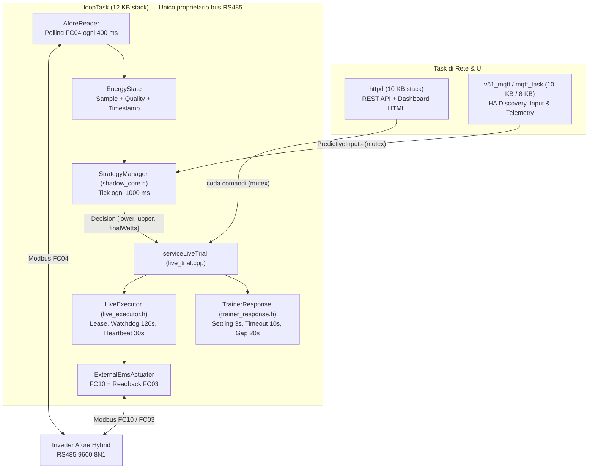
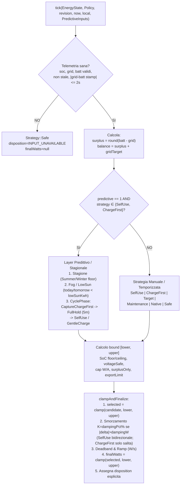
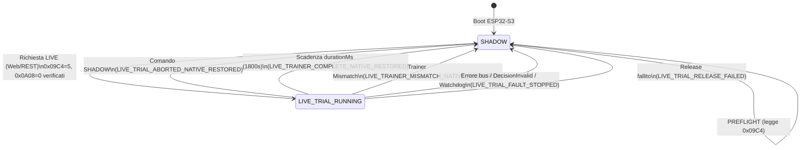

# Afore Autonomous EMS (v5.1) — Specifica Architetturale, Funzionale e Tecnica

> Documento di riferimento completo per comprendere, manutenere e replicare il controller EMS autonomo su ESP32-S3 (`afore-ems-v51-prototype`, stato `v5.1-live-trial-5`).

---

## Indice

1. [Panoramica e Principi Architetturali](#1-panoramica-e-principi-architetturali)
2. [Architettura Hardware e Ambiente di Build](#2-architettura-hardware-e-ambiente-di-build)
3. [Architettura Software e Modello di Concorrenza](#3-architettura-software-e-modello-di-concorrenza)
4. [Strato Fisico: Modbus RTU RS485 e Driver Afore](#4-strato-fisico-modbus-rtu-rs485-e-driver-afore)
5. [Motore Decisionale (`StrategyManager` / `shadow_core.h`)](#5-motore-decisionale-strategymanager--shadow_coreh)
6. [Esecuzione Controllata: SHADOW, `LiveExecutor` e `TrainerResponse`](#6-esecuzione-controllata-shadow-liveexecutor-e-trainerresponse)
7. [Interfacce Esterne: REST API, Web Console e MQTT / Home Assistant](#7-interfacce-esterne-rest-api-web-console-e-mqtt--home-assistant)
8. [Strategia di Test, Qualifica e Guida alla Replica](#8-strategia-di-test-qualifica-e-guida-alla-replica)

---

## 1. Panoramica e Principi Architetturali

Il sistema è un **Energy Management System (EMS) autonomo locale** progettato per funzionare su microcontrollore **ESP32-S3** collegato direttamente in RS485 a un inverter ibrido (profilo di riferimento: **Afore Hybrid `af5k_sl`**), senza dipendere dal cloud del costruttore per il controllo in tempo reale.

### 1.1 Principi cardine (Safety-by-Design)
1. **Separazione netta tra Decisione e Attuazione**:
   - Il core decisionale (`StrategyManager` in `src/v51/shadow_core.h`) è **puro, deterministico e privo di I/O**: riceve uno snapshot `EnergyState` + `Policy` + `PredictiveInputs` e produce una `Decision` con bound di sicurezza `[lower, upper]` e `disposition` esplicita.
   - È compilabile ed eseguibile su host (PC/Docker) per test unitari deterministici.
2. **Avvio sempre in `SHADOW` (fail-closed)**:
   - La build standard (`waveshare-1ch-v51`) **non linka alcun simbolo di scrittura Modbus** né attuatori.
   - La build di qualifica (`waveshare-1ch-v51-live-trial`) parte comunque in `SHADOW` a ogni boot; l'armamento in `LIVE` è **volatile** (non persiste al riavvio) e richiede richiesta esplicita via Web UI o REST API locale.
3. **Proprietà esclusiva del bus RS485**:
   - Tutte le transazioni Modbus (lettura e scrittura) avvengono su un **unico task** (`loopTask`). Le richieste HTTP/MQTT accodano intenti thread-safe ma non toccano mai direttamente la seriale.
4. **Ripristino garantito del modo nativo**:
   - Prima di entrare in `LIVE`, l'attuatore legge e memorizza il modo nativo dell'inverter (`0x09C4`, es. `1 = Self-Use`). Alla disattivazione, su errore di telemetria, su mismatch del Trainer o su scadenza watchdog/lease, l'EMS ripristina il modo nativo e lo verifica via readback FC03.

---

## 2. Architettura Hardware e Ambiente di Build

### 2.1 Piattaforma Target
- **MCU**: ESP32-S3 (`esp32-s3-devkitc-1`, dual-core 240 MHz, 320 KB SRAM interna, **8 MB PSRAM OPI**, **16 MB Flash QIO**).
- **Board di riferimento**: Waveshare ESP32-S3-RS485 (1 canale RS485 isolato, RTC I2C su `kRtcSda`/`kRtcScl`, uscita ausiliaria `GPIO47` mantenuta `OFF` nell'EMS).
- **Partizionamento Flash (`partitions_v51_16mb.csv`)**: doppio slot OTA (`app0` / `app1`, 6 MB per slot) con rollback automatico ESP-IDF se il nuovo firmware non supera la **probation di 60 s** (`pending_verify → valid`).

### 2.2 Ambienti PlatformIO (`platformio.ini`)

| Ambiente | Scopo | Flag principali | Simboli di scrittura |
|---|---|---|---|
| `waveshare-1ch-v51` | Produzione **SHADOW-only** (rollback sicuro) | `-DV51_BUILD_ID="v5.1-console-8-m9b"` | **0** (esclusi dal linker) |
| `waveshare-1ch-v51-live-trial` | Qualifica **Trainer & LIVE** | `-DV51_LIVE_TRIAL=1`, `V51_BUILD_ID="v5.1-live-trial-5"` | `live_trial.cpp`, `ExternalEmsActuator` |
| `waveshare-1ch-v51-ota-failure` | Test rollback OTA su banco | Simula boot fallito | Nessuno |

### 2.3 Sicurezza OTA
- Gli aggiornamenti via `POST /api/v1/ota` richiedono autenticazione Basic + header `X-Firmware-SHA256` e `X-Firmware-Signature` firmati con chiave privata **ECDSA P-256** (`ota-signing-key.pem`).
- Al boot nel nuovo slot, il sistema resta in `pending_verify` finché non supera la finestra di stabilità (60 s), altrimenti il bootloader esegue rollback automatico sullo slot precedente.

---

## 3. Architettura Software e Modello di Concorrenza

### 3.1 Diagramma dei Componenti

### 3.2 Task FreeRTOS e Budget di Memoria
Ogni task applicativo ha un gate di stack libero minimo `>= 1024 B` monitorato in `/api/v1/health`:
- `loopTask` (`12288 B`): ciclo principale (`delay(20)`), `reader.tick(millis())`, `tickEms(...)` ogni `1000 ms`, `serviceLiveTrial(...)`.
- `httpd` (`10240 B`): web server HTTP locale + REST API `/api/v1/*` + OTA upload.
- `v51_mqtt` (`10240 B`) e `mqtt_task` (`8192 B`): client ESP-MQTT, sottoscrizione `ems/command`, `forecast/solar`, `input/+`, pubblicazione `availability=online` **dopo** `MQTT_EVENT_SUBSCRIBED` (con fallback 2 s).
- Hardware Watchdog (`esp_task_wdt`): timeout `10 s` abilitato su `loopTask`.

---

## 4. Strato Fisico: Modbus RTU RS485 e Driver Afore

### 4.1 Parametri Seriali e Polling Telemetria (`v51_reader.cpp`, `af5k_sl.toml`)
- **Seriale**: `9600 baud, 8N1`, half-duplex su RS485, Unit ID default `1` (`1..247`).
- **Polling a blocchi FC04**: l'interrogazione avviene a blocchi contigui con intervallo **`400 ms`** in caso di successo (`1000 ms` su errore).
  - Poiché la telemetria è suddivisa in blocchi (batteria, PV, rete/inverter, temperature), ciascuna grandezza si aggiorna ogni **`~1.2–1.6 s`** (`ages_ms` tipici `0–1700 ms`).
  - Ogni misura è incapsulata in `Sample { value, stamp, Quality }` dove `Quality ∈ { Missing, Valid, ReadError, Invalid, Stale }` (`Stale` se `now - stamp > staleMs`, default `5000 ms`).

### 4.2 Mappa Registri Controllo External EMS (`external_ems_actuator.h`, `external_ems_frame.h`)

| Registro (Hex) | Funzione | Valori / Codifica | Note operative |
|---|---|---|---|
| `0x09C4` (`kMode`) | Modo operativo inverter | `1` = Self-Use (nativo tipico) `5` = `ExtEms` | Letto prima di armare; ripristinato al valore osservato al `release()` |
| `0x0A08` (`kControlType`) | Tipo controllo External EMS | `0` = `Controlled charging and discharging` (potenza batteria) | Deve valere `0` sia all'ingresso che prima di ogni scrittura |
| `0x0A09` (`kPower`) | Setpoint potenza attiva | `int32` big-endian su 2 registri (`high word` in `0x0A09`, `low word` in `0x0A0A`), unità `1 W` | Scritto con **FC10** (13 byte) + readback **FC03** |

### 4.3 Convenzione di Segno (`invert_live_sign`)
- **Convenzione interna EMS**: `+W` = carica batteria, `-W` = scarica batteria.
- **Convenzione fisica Afore verificata sul campo**: `+200 W` scritti senza inversione hanno prodotto **`-195 W`** di scarica.
- Impostando `invert_live_sign = true` (persistito in NVS sotto chiave `invert-sign`, congelato per tutta la durata della sessione `LIVE`), `ExternalEmsActuator` invia `wireWatts = -watts`:
  - EMS `+200 W` (carica) → `0x0A09 = -200` (`0xFFFFFF38`) → batteria carica a `+210 W`.
  - EMS `-200 W` (scarica) → `0x0A09 = +200` (`0x000000C8`) → batteria scarica a `-200 W`.

### 4.4 Resilienza RS485 in `writeAndReadBack()`
Sequenza di ogni attuazione:
1. Verifica `isExternalBatteryControl()` (`ownsBus() && 0x09C4 == 5 && 0x0A08 == 0`); altrimenti `lastError_ = "MODE_OR_CONTROL_LOST"`.
2. Costruzione frame FC10 (`externalPowerFrame`) e invio `bus_.writeFrame(...)`; se fallisce `lastError_ = "WRITE_FAILED"`.
3. Lettura FC03 di `0x0A09..0x0A0A`; se la prima lettura fallisce per errore I/O, esegue **1 singolo retry di sola lettura FC03**; se fallisce ancora `lastError_ = "READBACK_IO_FAILED"`.
4. Confronto bit-a-bit del `int32` letto con `wireWatts`; se diverso, **nessun retry**: `lastError_ = "READBACK_MISMATCH"` e arresto immediato fail-closed.

---

## 5. Motore Decisionale (`StrategyManager` / `shadow_core.h`)

### 5.1 Flusso Decisionale a ogni Tick (`1000 ms`)

### 5.2 Strategie Supportate
- **`SELF_USE` (0)**: bilancio rete a `gridTarget` (default `0 W`), carica con surplus FV, scarica fino a `floor` (con isteresi `resumeSoc`).
- **`CHARGE_FIRST` (1)**: priorità alla carica fino a `target` (con taper a `250 W` entro `hysteresis`). Se `surplusOnly == 1`, `upper` è limitato a `max(0, surplus)` e la scarica è bloccata (`lower = 0`): non preleva da rete ma non scarica su nuvole/picchi.
- **`NATIVE_INVERTER` (2)**: sola osservazione passiva.
- **`SAFE_MODE` (3)**: arresto sicuro (nessun comando attivo).
- **`TARGET_SOC` (4)**: carica calcolata su energia mancante `missingWh` rispetto a `deadlineSec` / `deadlineMinute` (gestione DST inclusa).
- **`MAINTENANCE` (5)**: porta a `maintenanceSoc` e mantiene per `maintenanceHoldSec` (es. calibrazione celle LFP); abortisce su fault di lettura.

### 5.3 Layer Predittivo e Stagionale (`predictive == 1`)
Quando attivo su `SelfUse` o `ChargeFirst`, utilizza gli input Home Assistant (`forecast_solar`, `forecast_ratio`, `weather`, `load_profile`):
- **Floor stagionale** (`autoSeason`): seleziona `winterFloor` (`20%`) tra `winterStart` (`10/25`) e `winterEnd` (`02/28`), altrimenti `summerFloor` (`10%`).
- **Rilevazione nebbia / poco sole (`low_sun_mode`)**: se `forecast < lowSunKwh` (`8 kWh`) o nebbia persistente (`fog`), attiva `CaptureChargeFirst`.
- **Ciclo di carica**: `CaptureChargeFirst` (cattura tutto il surplus FV fino al 100%) → `FullHold` (`fullHoldSec = 300 s`, mantenimento 100% per bilanciamento BMS) → `SelfUse` (o `GentleCharge` se serve recupero entro `deadlineMinute`). Lo stato del ciclo è persistito in NVS (`PredictiveCycleState` con `magic = 0xA5`).

### 5.4 Smorzamento Dinamico (`dampingW`, `dampingPct`)
Per eliminare il fenomeno di *hunting* dovuto al ritardo di attuazione/misura (`~1–2 s` su RS485 + rampa inverter) senza rallentare il loop da `1 s`:
- In **`SelfUse`**: la variazione rispetto a `priorW_` è tenuta ferma se `|delta| <= dampingW` (`50 W`), altrimenti applicata al `dampingPct` (`50%`).
- In **`ChargeFirst` (`!gridPermitted`)**: **risposta asimmetrica**:
  - Se il surplus **cala** (es. si accende un carico), `d.upper = max(0, surplus)` taglia `finalWatts` **istantaneamente** al ciclo successivo (zero prelievo intenzionale da rete).
  - Se il surplus **risale**, l'aumento oltre `priorW_` viene smorzato al `dampingPct%` (con deadband `dampingW`).

### 5.5 Parametri di `Policy` (Valori Default e Range Ammessi)

| Gruppo | Parametri principali (default) | Range validazione (`Policy::valid()`) |
|---|---|---|
| Limiti SoC & Tensione | `floor=20`, `resumeSoc=20`, `ceiling=100`, `minVolt=0`, `maxVolt=0` | `0 <= floor < ceiling <= 100`, `resumeSoc <= ceiling` |
| Potenze & Correnti | `charge=1000`, `discharge=1000`, `chargeFirstW=1000`, `targetW=1000`, `chargeA=50`, `dischargeA=50`, `exportLimit=3300` | `0..20000 W`, `0..500 A` |
| Dinamica & Smorzamento | `deadband=20`, `ramp=250`, `dampingW=50`, `dampingPct=50`, `staleMs=5000` | `dampingW: 0..1000`, `dampingPct: 1..100`, `ramp: 1..20000` |
| Predittivo & Stagione | `summerFloor=10`, `winterFloor=20`, `winterStart=1025`, `winterEnd=228`, `fullHoldSec=300`, `lowSunKwh=8` | `fullHoldSec: 1..86400`, `lowSunKwh: 0..100` |
| Trainer | `trainerSettleMs=3000`, `trainerAbsW=60`, `trainerPct=15`, `trainerTimeoutMs=10000`, `trainerGapMs=20000`, `trainerSec=1800` | `settle < timeout <= gap` (`gap: 2000..30000`, `sec: 10..1800`) |

---

## 6. Esecuzione Controllata: SHADOW, `LiveExecutor` e `TrainerResponse`

### 6.1 Macchina a Stati Operativa (`live_trial.cpp`)

### 6.2 `LiveExecutor` (`live_executor.h`)
- **Lease volatile**: se `trainer == true`, arma una lease finita (`trainerSec`, default `1800 s`).
- **Heartbeat 30 s (`kHeartbeatMs = 30000`)**: se il setpoint non cambia, non riscrive `0x0A09` finché non passano 30 s, poi lo rinnova.
- **Watchdog 120 s (`kWatchdogMs = 120000`)**: se non arriva una conferma valida entro 120 s, disarma e ripristina il modo nativo.
- **Validazione decisione**: rifiuta `Decision` più vecchie di `maxDecisionAgeMs` (`1000 ms`), `Safe`/`Native`, o con `finalWatts` fuori da `[lower, upper]`.

### 6.3 `TrainerResponse` (`trainer_response.h`) — Sorveglianza Fisica
Verifica che la potenza misurata della batteria (`battery_w`) segua effettivamente il setpoint confermato:
- **Finestra di assestamento (`trainerSettleMs = 3000 ms`)**: ignora campioni precedenti a `changed_ + 3000 ms`.
- **Tolleranza adattiva**: `max(trainerAbsW, |watts_| * trainerPct / 100)` (default `max(60 W, 15%)`).
- **Doppia scadenza anti-punto cieco**:
  1. `now - started_ >= trainerTimeoutMs` (`10 s`): timeout per il singolo setpoint corrente.
  2. `now - pendingSince_ >= trainerGapMs` (`20 s`): **timer indipendente dai cambi di setpoint**, che si azzera solo su `Result::Matched` reale. Impedisce che oscillazioni continue del comando mascherino una batteria bloccata.

---

## 7. Interfacce Esterne: REST API, Web Console e MQTT / Home Assistant

### 7.1 Endpoint HTTP (`10.0.0.110`, Basic Auth `admin:<password>`)
- `GET /` — Dashboard single-page (`src/v51/dashboard.html`) con flussi istantanei, strategie, limiti, stato LIVE/SHADOW (`modeBadge`) e diagnostica.
- `GET /api/v1/health` — Build ID, uptime, slot OTA, `ota_state`, heap/PSRAM, stack high-water mark per ogni task FreeRTOS, `modbus_write_count`, `mqtt_reconnect_count`.
- `GET /api/v1/telemetry` — Misure FC04 + derivate (`load_w`), `quality` e `age_ms` per ogni grandezza, `reads`, `errors`, `telemetry_valid`.
- `GET /api/v1/ems/decision` — Ultima `Decision` (`strategy`, `configured`, `predictive_phase`, `candidate_w`, `limited_w`, `simulated_w`, `safety_min_w`, `safety_max_w`, `disposition`, stato `ha_inputs`).
- `GET /api/v1/ems/replay/m9b` — Replay deterministico read-only (27 righe NDJSON su 15 scenari) senza impattare lo stato runtime.
- `GET /api/v1/manual` / `POST /api/v1/manual` — Stato e comandi:
  - `{"action": "operating_mode", "payload": {"mode": "PREFLIGHT" | "LIVE" | "SHADOW"}}`
  - `{"action": "live_sign", "payload": {"invert": true | false}}`
  - `{"action": "live_trainer", "payload": {"enabled": bool, "sample_s": 1..30}}`
- `GET /api/v1/logs` — Ring buffer log di sistema (eventi `EnergyState`, `LIVE_TRIAL`, `TRAINER MATCH/MISMATCH`, fase di stop).
- `POST /api/v1/ota` — Upload firmware firmato ECDSA P-256.

### 7.2 Integrazione MQTT & Home Assistant (`m4.cpp`, `afore_esp_inputs.yaml`)
- **Topic sottoscritti**: `afore/afore-ems/v1/ems/command` (rifiuta comandi `RETAINED`), `forecast/solar`, `input/forecast_ratio`, `input/weather`, `input/load_profile`, `input/heartbeat`.
- **Availability**: `afore/afore-ems/v1/availability` (`online`/`offline` via LWT).
- **Discovery**: entità auto-configurate per Home Assistant, con aggiornamento stato e ACK su `ems/ack`.

---

## 8. Strategia di Test, Qualifica e Guida alla Replica

### 8.1 Piramide di Verifica (da eseguire in ordine)
1. **Test Unitari Host (C++17, zero hardware)**:
   - `test/v51_shadow_core/main.cpp`: copre strategie, stagionalità, `FullHold`, `disposition`, smorzamento `SelfUse` e asimmetria `ChargeFirst`.
   - `test/v51_live_executor/main.cpp`: copre codec frame FC10 (`externalPowerFrame`), takeover `0x09C4/0x0A08`, `LiveExecutor` (lease, watchdog, release), retry FC03 vs mismatch, e `TrainerResponse` (incluso test batteria bloccata con setpoint variabili entro `trainerGapMs`).
2. **Verifica Build SHADOW-only**:
   - `pio run -e waveshare-1ch-v51` + scansione simboli ELF (`xtensa-esp32s3-elf-nm -C`) per verificare `0` simboli di scrittura Modbus.
3. **Qualifica sul Campo (`waveshare-1ch-v51-live-trial`)**:
   - Avviare sempre `python tools/capture_v51_live_trial.py --host <IP> --password-file <FILE> --seconds <SEC> <OUT.ndjson>` **prima** di selezionare `LIVE`.
   - Step A: verifica polarità (`invert_live_sign`) e risposta a bassa potenza (`±200 W` carica, `0 W`, `-200 W` scarica) con confronto su portale inverter.
   - Step B: prova estesa (30 min) analizzando 4 metriche chiave dal file NDJSON:
     1. Media di `|grid_w - gridTarget|` (qualità di regolazione).
     2. Scritture Modbus al minuto (impegno bus RS485).
     3. Tempo massimo senza conferma fisica `TrainerResponse` (sorveglianza effettiva).
     4. Wh prelevati dalla rete durante `ChargeFirst` solo surplus FV.

### 8.2 Checklist per Replicare l'EMS su un Nuovo Impianto
1. **Hardware**: collegare ESP32-S3-RS485 al bus RS485 dell'inverter verificando assenza di altri master concorrenti (o riconciliando SEM/logger).
2. **Profilo & Segno**: verificare registro nativo `0x09C4`, `0x0A08 == 0`, baudrate `9600 8N1`, e validare la polarità di `0x0A09` con un test Trainer a `±200 W`.
3. **Sicurezza chiavi**: generare coppia chiavi ECDSA P-256 per OTA e impostare password admin locale; mantenere `waveshare-1ch-v51` (SHADOW) come immagine di rollback pronta.
4. **Taratura sito**: impostare `capacityWh`, `nominalMv`, `charge`/`discharge`, `exportLimit`, `winterFloor`/`summerFloor` e `lowSunKwh` in base a batteria e contratto di rete.
