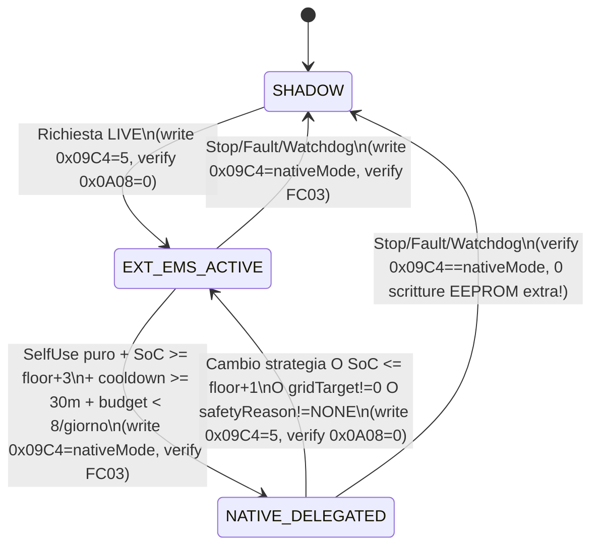

# Piano di Implementazione: Polling `Priority.HIGH/LOW` + Delega Sicura `Self-Use` Nativo

> **Target repository**: `c:\Users\gianv\Documents\Progetti\ESP\afore-ems-v51-prototype` (branch `v51-prototype`, base `v5.1-live-trial-7`)  
> **Obiettivo**:
> 1. Eliminare lo sfasamento di `800–1200 ms` tra `grid_w` e `battery_w` tramite polling `Priority.HIGH / LOW` in `v51_reader.cpp`.
> 2. Implementare una delega **opzionale e protetta anti-usura EEPROM** al `Self-Use` nativo dell'inverter (`0x09C4 = nativeMode`) durante la fase `SelfUse` pura, mantenendo `ExtEms` (`0x09C4 = 5`) per tutte le strategie attive (`CaptureChargeFirst`, `GentleCharge`, `FullHold`, `TargetSoC`, `Maintenance`, `Reserve`).

---

## Parte 1 — Polling Modbus `Priority.HIGH / LOW` (`v51_reader.cpp`)

### 1.1 Problema attuale
In `profiles/afore/af5k_sl.toml` sono definiti 4 blocchi FC04 letti in round-robin ogni `400 ms`:
- Blocco 0: `addr = 507, count = 24` → **Rete + Inverter** (`grid.power`, `ac.power.total`, `grid_v`, `hz`) — **CRITICO (`HIGH`)**
- Blocco 1: `addr = 552, count = 9` → **PV1 / PV2** (`dc.power.total`, `pv1_*`, `pv2_*`) — **SECONDARIO (`LOW`)**
- Blocco 2: `addr = 2000, count = 9` → **Batteria** (`soc`, `soh`, `battery.voltage`, `battery.current`, `battery.power`, `battery.temperature`) — **CRITICO (`HIGH`)**
- Blocco 3: `addr = 2515, count = 1` → **Temperatura radiatore** — **SECONDARIO (`LOW`)**

Poiché `552` sta in mezzo tra `507` e `2000`, `|grid.stamp - battery.stamp|` è sempre **`~800–1200 ms`**, introducendo errore transitorio in `surplus = *batt - *grid` sui gradini di carico.

### 1.2 Schedulazione target (`src/drivers/afore/v51_reader.h`, `src/drivers/afore/v51_reader.cpp`)
Introdurre una sequenza di polling a 3 passi per ciclo (`~900–1000 ms` per ciclo completo):
- **Step 0 (`HIGH-1`)**: leggi blocco `507` (rete/inverter) → prossimo poll tra **`150 ms`** (`kHighPairGapMs = 150`).
- **Step 1 (`HIGH-2`)**: leggi blocco `2000` (batteria/SoC) → prossimo poll tra **`350 ms`** (`kPostPairGapMs = 350`).
- **Step 2 (`LOW`)**: leggi 1 blocco secondario a rotazione (`552` nei cicli pari, `2515` nei cicli dispari) → prossimo poll tra **`350 ms`** (`kPostLowGapMs = 350`).
- Su errore (`!ok`): mantenere backoff conservativo `1000 ms` (invariato) e `failures_ >= 3 → readHalted` (invariato).

**Risultato atteso**:
- `|grid.stamp - battery.stamp|` scende da **`800–1200 ms`** a **`~150–250 ms`**.
- `grid_w` e `battery_w` si aggiornano ogni **`~0.9–1.0 s`** (invece di `~1.6 s`).
- `PV` (`552`) e `temp` (`2515`) si aggiornano ogni **`~1.8–2.0 s`** (ampiamente sotto `staleMs = 5000 ms`).
- Traffico bus RS485 `9600 8N1`: ~`3` transazioni/s (invariato rispetto al budget seriale sicuro).

### 1.3 File da modificare (Parte 1)
1. `src/drivers/afore/v51_reader.h`: aggiungere indici/stato scheduler (`uint8_t phase_ = 0; uint8_t lowIndex_ = 0;`).
2. `src/drivers/afore/v51_reader.cpp`:
   - Identificare dinamicamente (o per indirizzo `507` / `2000`) i blocchi `HIGH` e `LOW` da `kBlocks` così da restare compatibile con `v51_profile_generated.h`.
   - Sostituire `block_ = (block_ + 1) % kBlockCount` con la sequenza `HIGH-1 (507) → HIGH-2 (2000) → LOW (alternato 552/2515)`.
   - Mantenere intatti `observeBus()`, `kSocProbe` iniziale e il logging `FC04_BLOCK` / `FC04_FIELD` al boot.
3. `src/v51/main.cpp`: esporre `grid_batt_skew_ms = abs(grid.stamp - battery.stamp)` nel log `EnergyState` per verifica immediata sul campo.

---

## Parte 2 — Delega Sicura al `Self-Use` Nativo dell'Inverter (Anti-usura EEPROM)

### 2.1 Principio architetturale
- **Default `OFF`** (`Policy::delegateNativeSelfUse = 0`): nessuna modifica al comportamento attuale finché l'operatore non lo abilita esplicitamente.
- **Disabilitato automaticamente in modalità Trainer (`trainer == true`)**: il Trainer deve sempre verificare il controllo attivo di `0x0A09` (`battery_w` vs setpoint). La delega al nativo si attiva solo in **LIVE continuo** (`trainer == false`) o tramite flag dedicato.

### 2.2 Condizioni di ingresso in `NativeDelegated` (`0x09C4 = nativeMode`)
La delega è ammessa **solo** se **tutte** le seguenti condizioni sono vere contemporaneamente:
1. `trialPolicy.delegateNativeSelfUse == 1` e `!trainer`
2. `healthy == true` e `decision.strategy == Strategy::SelfUse`
3. `trialPolicy.gridTarget == 0` (il `Self-Use` nativo dell'inverter bilancia sempre a ~`0 W`)
4. `soc >= decision.effectiveFloor + std::max(trialPolicy.hysteresis, 3)` (margine di sicurezza di almeno +3 punti SoC sopra il floor stagionale, es. `>= 23%` in inverno, `>= 13%` in estate)
5. `decision.safetyReason == "NONE"` (nessun limite tensione, né `SOC_RESERVE`, né `SOC_CEILING`)
6. **Guardia EEPROM soddisfatta**:
   - Tempo trascorso dall'ultima scrittura su `0x09C4` `>= nativeSwitchCooldownSec` (default **`1800 s` = 30 min**).
   - Contatore giornaliero di scritture su `0x09C4` `< maxModeSwitchesPerDay` (default **`8` scritture/giorno** → `< 2.920/anno`, durata EEPROM >30–100 anni).

### 2.3 Condizioni di ripresa immediata di `ExtEms` (`0x09C4 = 5`) — *Safety bypassa il cooldown*
L'EMS **riprende subito** `ExtEms` (`enterExternalBatteryControl()`) ignorando il cooldown di 30 min se si verifica **una qualunque** di queste condizioni:
1. `decision.strategy != Strategy::SelfUse` (es. ingresso in `CaptureChargeFirst`, `GentleCharge`, `FullHold`, `Target`, `Maintenance`)
2. `soc <= decision.effectiveFloor + 1` (sta per raggiungere il floor stagionale → serve `ExtEms` con `lower = 0` per impedire all'inverter nativo di scaricare sotto il floor!)
3. `trialPolicy.gridTarget != 0`
4. `decision.safetyReason != "NONE"` (es. `VOLTAGE_LIMIT`, `SOC_RESERVE`)
5. **Verifica periodica (ogni `30 s`)**: se la lettura FC03 di `0x09C4` mostra che qualcuno ha cambiato il modo fuori da `nativeMode`, arresto fail-closed (`LIVE_TRIAL_FAULT_STOPPED`).

### 2.4 Diagramma a Stati Esteso (`LiveExecutor` / `live_trial.cpp`)

### 2.5 Protezione EEPROM dettagliata (File da modificare)
1. `src/v51/shadow_core.h` (`Policy`):
   - Aggiungere `int delegateNativeSelfUse = 0;` (`0` o `1`)
   - Aggiungere `int nativeSwitchCooldownSec = 1800;` (`300..7200`)
   - Aggiungere `int maxModeSwitchesPerDay = 8;` (`2..24`)
   - Aggiornare `Policy::valid()` con i range sopra.
2. `src/device/live_actuator.h` & `src/drivers/afore/external_ems_actuator.h`:
   - Aggiungere metodo `bool verifyNativeMode()` (sola lettura FC03 di `0x09C4 == nativeMode_`, nessuna scrittura) e `bool enterNativeMode()` (wrapper controllato che delega a `release()`).
   - Assicurare che `release()` **non** scriva `0x09C4` se il registro vale già `nativeMode_` (già presente a riga 65 di `external_ems_actuator.h`: `if (mode != kExternalMode) return mode == nativeMode_;` — ottimo!).
3. `src/v51/live_executor.h`:
   - Aggiungere stato `LiveStatus::NativeDelegated` e metodi:
     - `LiveResult delegateNative(uint32_t now)` → chiama `actuator_.release()`, aggiorna `lastModeSwitchMs_`, incrementa `dailyModeSwitches_`, non invia `0x0A09`.
     - `LiveResult resumeExternal(uint32_t now)` → chiama `actuator_.enterExternalBatteryControl()`, aggiorna `lastModeSwitchMs_`, incrementa `dailyModeSwitches_`, ripristina `confirmedAt_ = now`.
     - Durante `NativeDelegated`, `tick(...)` ogni `30 s` chiama `actuator_.verifyNativeMode()` per verificare il bus e rinnovare il watchdog senza scrivere `0x0A09`.
   - Gestire reset di `dailyModeSwitches_` al cambio giorno locale (o ogni 86400 s di uptime se `local` non disponibile).
4. `src/v51/live_trial.cpp` & `src/v51/ems_runtime.cpp` & `src/v51/dashboard.html`:
   - Esporre in `/api/v1/manual`: `live_delegated_native` (bool), `mode_switches_today` (int), `mode_switch_cooldown_remaining_s` (int).
   - Esporre i 3 parametri `Policy` in `/api/v1/ems/policy` (persistenza NVS) e nella tab *Strategie EMS* / *Sistema* della dashboard.
   - Incrementare `V51_BUILD_ID` in `src/v51/live_trial.h` (es. `v5.1-live-trial-8`).

---

## Parte 3 — Piano di Test e Criteri di Accettazione (Obbligatori per l'Agente)

### 3.1 Test Unitari Host (`g++ -std=c++17 -Wall -Wextra -Werror`)
1. **`test/v51_shadow_core/main.cpp`**:
   - Verificare `Policy::valid()` per `delegateNativeSelfUse`, `nativeSwitchCooldownSec` (rifiuta `< 300` o `> 7200`), `maxModeSwitchesPerDay` (rifiuta `< 2` o `> 24`).
   - Verificare che tutti i test predittivi/damping esistenti restino 100% verdi.
2. **`test/v51_live_executor/main.cpp`**:
   - **Test delega & cooldown**: entra in `NativeDelegated` quando idoneo → verifica `0` scritture su `0x0A09` durante la delega → verifica che un secondo tentativo prima del cooldown (`< 1800 s`) resti bloccato.
   - **Test safety bypass**: in `NativeDelegated`, simulare `soc <= effectiveFloor + 1` o cambio strategia a `ChargeFirst` → deve riprendere `ExtEms` (`0x09C4 = 5`) **immediatamente** anche durante il cooldown.
   - **Test budget EEPROM giornaliero**: dopo `maxModeSwitchesPerDay` transizioni, la delega viene rifiutata e il sistema resta stabilmente in `ExtEms` (solo scritture RAM `0x0A09`), ma `disarm()` finale verso `SHADOW` riesce comunque sempre.
   - **Test stop senza scrittura doppia**: chiamare `disarm()` mentre in `NativeDelegated` → deve verificare `0x09C4 == nativeMode` con **0 scritture aggiuntive**.

### 3.2 Build & Regressione SHADOW-only
1. `pio run -e waveshare-1ch-v51` → `SUCCESS`, `0` warning, `0` simboli di scrittura Modbus nell'ELF (`xtensa-esp32s3-elf-nm -C`).
2. `pio run -e waveshare-1ch-v51-live-trial` → `SUCCESS`, `0` warning.

### 3.3 Verifica sul Campo (post-OTA su `10.0.0.110`)
1. **Step A — Verifica `Priority.HIGH/LOW` in `SHADOW`**:
   - Controllare su `/api/v1/logs` e `/api/v1/telemetry` che `|grid.age_ms - battery.age_ms|` sia **`<= 250 ms`** (vs `800–1200 ms` precedenti) con `errors == 0` su almeno 500 letture consecutive.
2. **Step B — Test `LIVE` con gradino di carico + scarica (`delegateNativeSelfUse = 0`)**:
   - Eseguire prova con accensione/spegnimento carico `1–1.5 kW` e prova di scarica serale (`-W`), confrontando `media |grid_w|` e `conferme/min` con la `trial-7`.
3. **Step C — Test `LIVE` con `delegateNativeSelfUse = 1` (LIVE continuo)**:
   - Verificare una transizione completa `ChargeFirst (ExtEms) → FullHold → SelfUse (NativeDelegated, 0x09C4 = 1, 0 scritture 0x0A09) → Floor+1 (Retake ExtEms, 0x09C4 = 5)` confermando `mode_switches_today <= 2`.
